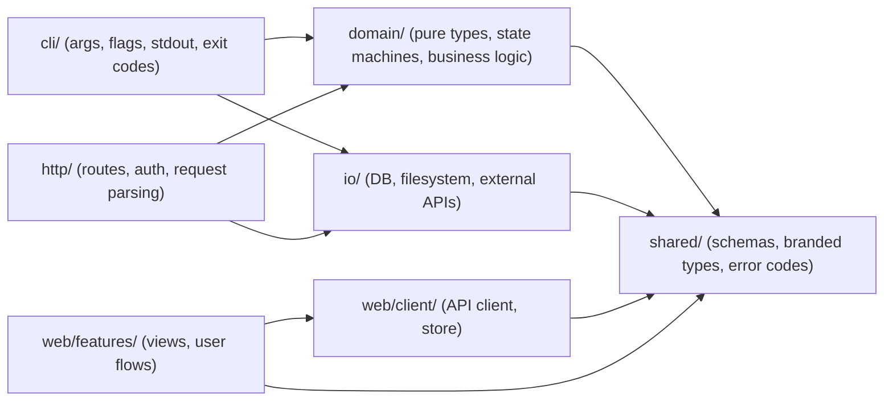
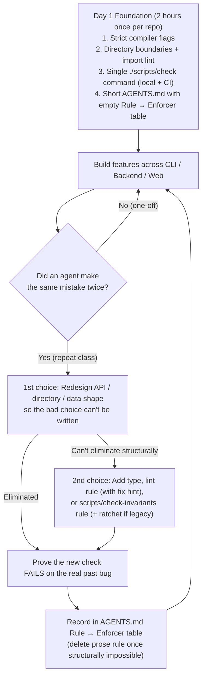

# Building a Codebase & Static Analysis Foundation (The `poteto` / `pstack` Way)

> **Focus:** Deep-dive into **Layers 1 & 2** of Lauren Tan's Inverse Pyramid of Trust—**Codebase Architecture** and **Static Analysis**—synthesized directly from [`pstack`'s leaf principles](../../pstack/skills), [`typescript-best-practices/references/patterns.md`](../../pstack/skills/typescript-best-practices/references/patterns.md), [`skills/correct/SKILL.md`](../../pstack/skills/correct/SKILL.md), [`scripts/check-pstack-docs.mjs`](../../scripts/check-pstack-docs.mjs), and [*"All Code Is Slop (Except Mine)"*](https://www.youtube.com/watch?v=O_zcc6Xl12g).

---

## 1. The Single Axiom That Explains Everything

Hidden on line 11 of [`pstack/skills/correct/SKILL.md`](../../pstack/skills/correct/SKILL.md#L11) is the mental model behind every architectural and static-analysis choice in `pstack`:

> **"Assume every contributor is an agent that sees only the files it opened, copies the nearest example, and takes the shortest path that compiles. Design the repo so a change that looks right from one file is right for the whole repo."**

Re-read that sentence carefully. Traditional software engineering assumed a contributor held the whole system's folklore in their head. **Agent-era software engineering assumes local-context contributors.**

That creates three hard design laws:

1. **Local Correctness Must Imply Global Correctness:** If an agent opens *only* `src/routes/orders.ts` and writes the shortest code that compiles, the repository structure and compiler must make it **impossible** for that code to violate global invariants (like bypassing auth, touching the wrong thread, calling a raw DB client, or duplicating an enum).
2. **Every Bad Example Is a Contagion ("Weeds in the Garden"):** Leaving even one legacy helper, commented-out `setTimeout` workaround, or `as any` cast in the repo trains every future agent to reproduce it. Pruning dead code ([`principle-subtract-before-you-add`](../../pstack/skills/principle-subtract-before-you-add/SKILL.md), [`principle-migrate-callers-then-delete-legacy-apis`](../../pstack/skills/principle-migrate-callers-then-delete-legacy-apis/SKILL.md)) is no longer "nice-to-have cleanup"—it directly determines the quality of your next 100 agent outputs.
3. **Deterministic Checks Beat Prose Every Time:** Prose in `AGENTS.md` or code comments is advisory; compilers and linters are physical laws. Static analysis converts *judgment you had to repeat* into *walls an agent bounces off automatically and fixes before you ever see the diff*.

---

## 2. Layer 1 Deep-Dive: Codebase Architecture as an Agent Steering System

Layer 1 makes the **right path the shortest path that compiles** and removes dangerous choices before static analysis even has to catch them.

### 2.1 One Owner, One Way, Local Truth
From [`skills/architect/SKILL.md`](../../pstack/skills/architect/SKILL.md) and [`skills/correct/SKILL.md`](../../pstack/skills/correct/SKILL.md):
- **Each piece of state has one owner.** Never mirror the same truth across two stores, two configs, or a hand-synced list + code switch. Derive everything from one authoritative source.
- **Each task has one supported way.** If your repo has *both* `fetch()` and an internal `apiClient()`, or *both* an old v1 store and a v2 store, agents will randomly pick the wrong one depending on which file they opened first. Migrate callers and delete the old way in a single wave.
- **Hide internals structurally.** Don't just ask agents not to import internals—only export the safe public entry point (package `exports` map in Node/TS, `internal/` packages in Go, `pub(crate)` / module privacy in Rust, `_internal/` + import lint in Python/TS).

### 2.2 Context Through Directory Structure
From Lauren Tan's Dune example (`electron-main/` vs. `electron-renderer/` vs. `shared/`):
- **Name top-level directories after runtime/architectural boundaries, not generic technical buckets.**
- When an agent opens a file inside `src/domain/`, the path itself tells the agent "pure logic, zero I/O." When it opens `src/boundaries/http/`, the path tells it "parse untrusted input here, call `domain/`, map errors to HTTP."
- Combine **self-explanatory directory names** with a **dependency-graph rule** so imports can only flow in one direction:



Notice what is **forbidden** here:
- `domain/` **never** imports `cli/`, `http/`, `io/`, or `web/` (keeps business logic 100% pure and testable without mocks).
- `http/` and `cli/` **never** import raw DB drivers directly if `io/repos/` owns persistence (or only via explicit repository boundaries).
- `web/` **never** imports backend `io/` or `http/`—only `shared/` contracts/schemas.

### 2.3 Boundary Discipline (The Two-Question Filter)
From [`principle-boundary-discipline`](../../pstack/skills/principle-boundary-discipline/SKILL.md):
Agents love sprinkling defensive `if (!x) return;` checks everywhere—which creates noisy code and hides real bugs. Replace defensive slop with **two sharp tests**:
1. **Is this data crossing a system boundary right now?** (CLI args, env vars, config files, HTTP bodies, DB rows, IPC, `JSON.parse`). If **yes**, parse it *once* into a trusted domain type using your schema library (`zod`, `pydantic`, `serde`, `encoding/json` + validator). If **no**, *trust the internal type*—no redundant null checks or re-validation.
2. **Can this be a pure function the shell just calls?** If **yes**, pull it out of the framework/CLI/route wrapper into `domain/` so the shell stays thin and dumb.

### 2.4 Constructive Modeling & The "Simplest Total Type" Rule
From [`typescript-best-practices/references/patterns.md`](../../pstack/skills/typescript-best-practices/references/patterns.md) (language-agnostic ideas shown in TS):

1. **Make illegal states unconstructable instead of writing comments or runtime guards:**
   - **Discriminated unions over boolean/optional bags:**
     ```ts
     // BAD: allows { loading: true, diff: ..., error: "..." } simultaneously
     type DiffState = { loading: boolean; diff?: GitDiff; error?: string };

     // GOOD: impossible combinations cannot compile
     type DiffState =
       | { kind: "loading" }
       | { kind: "ready"; diff: GitDiff }
       | { kind: "error"; error: string };
     ```
   - **Constructive shapes over comment-held invariants:**
     ```ts
     // BAD: invariant lives in a comment an agent will ignore
     type TimeRange = { start: Date; end: Date }; // invariant: start <= end

     // GOOD: negative range cannot even be represented; derive end() helper
     type TimeRange = { start: Date; durationMs: NonNegativeMs };
     ```
     Similarly: `type NonEmpty<T> = [T, ...T[]]` instead of `T[]` + repeated `if (arr.length === 0) throw`, and `type Pairs<T> = [T, T][]` for even-length sequences.
   - **Brand semantic primitives:** Prevent agents from swapping `(userId, orgId)` or `(ms, seconds)` when both are `string` or `number`. Create branded values **only** through a validating constructor/type guard—never with `as`.
   - **Schema as single source of truth:** Derive types from Zod / OpenAPI / SQLc / Protobuf (`z.infer<typeof Schema>`), and if a hand-written type comes first, annotate the schema (`const schema: z.ZodType<User> = ...`) so the compiler fails if the validator proves *less* than the type!
   - **Exhaustiveness checks:** Put `const _exhaustive: never = state;` in every union `switch` default so adding a new variant immediately lights up every single file an agent needs to update.

2. **Anti-Over-Engineering Guardrail — "Simplest Total Type":**
   Don't over-brand everything by reflex! Keep plain `T[]` whenever every operation on it is already total (like `sum`). Strengthen a type to `NonEmpty<T>` or a brand **only when the loose type forces a lie at a call site**—the tells are `!`, `as T`, or `throw new Error("should never happen")`.

### 2.5 Minimize Reader Load (The 30-Second Agent Test)
From [`principle-minimize-reader-load`](../../pstack/skills/principle-minimize-reader-load/SKILL.md):
Agents burn context tokens chasing indirection just like humans burn working memory. Guard both axes of reader load:
- **Axis 1 (Indirection depth):** Collapse one-caller wrappers, pass-through adapters with no second implementation, and "enterprise service layers" that only forward arguments.
- **Axis 2 (State scope):** Prefer `return values > locals > instance fields > module state > globals`. Derive values instead of syncing state.
- **The 30-Second Test:** Can a fresh agent (or future you) open a file and answer *"where does `X` come from?"* and *"what can mutate `X`?"* in under 30 seconds? If not, cut layers or cut shared mutable state.

### 2.6 Ban Nuanced Footguns Locally (The Dune Principle)
In the talk, Lauren banned `useEffect` in ordinary product code—not because `useEffect` is universally evil, but because **anything that requires deep nuance to use safely produces AI slop at scale**.
- **Rule of thumb for your solo projects:** Identify the 2–4 APIs in your stack that require subtle mental models (e.g., raw `useEffect`, `setTimeout` in UI, raw SQL string concatenation, unawaited promises, `any` / `as`, raw `fs.writeFileSync` bypassing atomic writes). Wrap the safe pattern in a single helper inside your core/framework layer, and **ban the raw API everywhere else via lint**.

---

## 3. Layer 2 Deep-Dive: Static Analysis Designed *for* Agents

Most teams configure linters for humans (stylistic formatting, terse error codes like `no-restricted-imports`). **`poteto`-style static analysis treats lint errors and CI scripts as high-signal, un-ignorable prompts to the agent.**

### 3.1 The 5 Pillars of Agent-Grade Static Analysis

| Pillar | What It Enforces | Concrete Tooling (Pick Your Stack) |
|---|---|---|
| **1. Strict Compiler / Type Checker** | Rejects null/undefined holes, unchecked index access, implicit `any`, non-exhaustive switches, unused code. | **TS:** `strict: true`, `noUncheckedIndexedAccess: true`, `exactOptionalPropertyTypes: true`, `noImplicitOverride: true`. **Python:** `pyright --strict` / `mypy --strict`. **Go:** `go vet` + `golangci-lint` (`exhaustive`). **Rust:** `#![deny(clippy::unwrap_used)]` in prod crates. |
| **2. Dependency-Graph / Boundary Enforcement** | Prevents cross-layer imports (e.g., `domain/` importing `io/`, `routes/` importing `db`, `web/` importing `server/`). | **TS/JS:** `dependency-cruiser` or ESLint `no-restricted-imports` / `eslint-plugin-boundaries` / Biome. **Python:** `import-linter` / `tach`. **Go:** `internal/` packages + `depguard`. **Rust:** Cargo workspace crate boundaries. |
| **3. Footgun & Escape-Hatch Bans** | Blocks `as` casts, `any`, `@ts-ignore`, unapproved `eslint-disable`, raw `console.log`, banned APIs (`useEffect`, `setTimeout`). | ESLint (`@typescript-eslint/no-explicit-any`, `no-restricted-syntax`), Ruff (`BLE`, `S`, `B`), Clippy, Semgrep. |
| **4. Custom Repo-Invariant Scripts** | Checks domain/repo rules generic linters don't know (doc drift, unregistered CLI flags, every route has a schema, every feature has a verification map entry). | Small 50–150 line scripts in `scripts/check-*.mjs` or `.py` (modeled directly on [`scripts/check-pstack-docs.mjs`](../../scripts/check-pstack-docs.mjs)). |
| **5. Comment & Suppression Hygiene** | Prevents agents from excusing workarounds with prose comments or suppressing real correctness checks. | Lint rule requiring expiry + reason on suppressions, plus pre-merge `/no-comments` review. |

### 3.2 Write Lint Errors That Tell the Agent the Exact Fix
Look at the difference between a standard lint error and a `poteto`-grade lint error (from [`correct/SKILL.md`](../../pstack/skills/correct/SKILL.md#L20)):

- **Weak error (causes agent thrashing):**
  ```text
  error: 'src/io/db' import is restricted from being used. (no-restricted-imports)
  ```
- **Agent-grade error (self-corrects in 1 turn):**
  ```text
  error: Do not import 'src/io/db' inside 'src/http/routes/'.
  Routes must call typed repository functions in 'src/io/repos/' (see 'src/io/repos/users.ts')
  so queries stay parameterized and testable.
  ```

When the error names the **exact file, type, or function to use instead**, the agent immediately reads that example file and writes idiomatic code on the very next turn—zero human intervention.

### 3.3 The Ratchet Pattern (Hardening Existing Projects Without a Big-Bang Rewrite)
What if you already have an existing solo project with 40 `any` casts, 15 `useEffect` calls, or 8 boundary violations? From [`correct/SKILL.md`](../../pstack/skills/correct/SKILL.md#L20):
> *"If the pattern is already common, fail only when a change adds more."*

Build a tiny **ratchet check** (30 lines of script):
1. Commit a `scripts/ratchet-baseline.json` storing the current count of each banned pattern (e.g., `{ "as_any": 14, "raw_db_in_routes": 5 }`).
2. Your check script scans the codebase:
   - If `current > baseline` → **FAIL** with a fix message pointing to the exact file/line added.
   - If `current < baseline` → **PASS** and print *"Great! Lower `ratchet-baseline.json` from 14 → 12 so this win is locked in."* (Or auto-update on `--update`.)
3. Result: **zero new slop can ever enter**, and existing debt monotonically shrinks to zero without halting feature work.

### 3.4 Three Non-Negotiable Rules for Maintaining Static Checks
From [`correct/SKILL.md`](../../pstack/skills/correct/SKILL.md#L26):
1. **Prove every new check fails on a real past mistake:** Before committing a lint rule or `scripts/check-*.mjs`, run it against the actual buggy commit or snippet that motivated it and verify it catches it. A check you've never seen fail proves nothing.
2. **Run the exact same command locally and in CI:** One single entry point—e.g., `just check` or `npm run check` or `./scripts/check`—that runs `typecheck + lint + boundary-check + repo-invariants + unit-tests`. Every agent harness (Cursor, Claude Code, Antigravity, Codex) calls that one command.
3. **Time-boxed exceptions only:** If a real exception is unavoidable, require it inline with **reason + expiry date + your sign-off** (e.g., `// lint-exception(expires:2026-12-31): vendor SDK types missing foo — tracked in #42`). A tiny check script fails CI once an expiry date passes so exceptions never rot into permanent weeds.

---

## 4. How to Build & Manage This Foundation Across Your Solo Projects

### 4.1 Your Standard Solo Project Skeleton (CLI + Backend + Web/App)

Adopt one predictable repo anatomy across your projects so both **you** and **all your AI harnesses** get instant orientation:

```text
my-project/
├── AGENTS.md                        # Short (<120 lines): architecture map, `check` command, Rule → Enforcer table
├── CLAUDE.md                        # 1 line: "Read AGENTS.md before doing anything."
├── .cursor/rules/core.mdc           # Thin pointer to AGENTS.md
├── packages/ (or src/)
│   ├── shared/                      # Authoritative schemas (Zod/OpenAPI), branded IDs, error types (ZERO runtime I/O)
│   ├── domain/                      # Pure business logic, state machines, reducers (imports ONLY shared/)
│   ├── io/                          # DB repos, filesystem, external API adapters (imports shared/, domain/)
│   ├── cli/                         # Thin CLI shell: arg parsing, --format json, --dry-run (imports domain/, io/)
│   ├── server/                      # Thin HTTP/RPC shell: auth, boundary parse, status codes (imports domain/, io/)
│   └── web/                         # UI frontend: ui/, features/, client/ (imports ONLY shared/)
├── scripts/
│   ├── check                        # ONE entry point run locally & in CI: types + lint + boundaries + invariants + tests
│   ├── check-invariants.*           # Custom repo checks (doc drift, ratchet counts, expired exceptions, CLI flags)
│   └── verify-ctl                   # Reusable runtime verification lever (doctor, seed, drive, snapshot)
└── docs/
    └── verification/                # User-POV Feature Map (CLI + API + UI)
```

### 4.2 The Day-1 vs. Ongoing Management Loop

You don't build all static analysis up front—you **scaffold the skeleton on Day 1, then grow it strictly from real mistakes** so every single rule earns its keep:



### 4.3 Concrete Starter Checklist: Your First 6 Static Rules (High Signal, Low Noise)

If you set up **just these 6 checks** in any new or existing solo project, you eliminate ~80% of recurring AI slop across CLI, backend, and web:

1. **Strict Compiler Mode** — zero implicit `any`, checked array/map indexing (`noUncheckedIndexedAccess`), exhaustive union checking.
2. **One-Way Dependency Graph** — enforce `shared ← domain ← {io, cli, server}` and `shared ← web`; ban `domain/` from importing I/O or frameworks, and ban `server/routes/` from importing raw DB clients directly.
3. **Escape-Hatch Ban** — ban `as any`, `@ts-ignore`, `@ts-expect-error`, and bare `eslint-disable` / `noqa` without a reason + expiry date.
4. **Boundary Parsing Enforcement** — external inputs (`JSON.parse`, `process.env`, HTTP `req.body`, CLI flags) must pass through a schema parser in a boundary module, never cast with `as`.
5. **One Custom Repo-Invariant Script (`scripts/check-invariants`)** — start with 3 tiny checks:
   - Fails if any `lint-exception(expires:YYYY-MM-DD)` is past today's date.
   - Fails if ratchet counts increase over `ratchet-baseline.json`.
   - Fails if key docs/feature maps reference nonexistent paths or commands (just like [`scripts/check-pstack-docs.mjs`](../../scripts/check-pstack-docs.mjs)).
6. **Single-Command Gate (`./scripts/check`)** — runs all static checks in **under 5–10 seconds** locally and in GitHub Actions so agents run it after *every* small verifiable unit without friction.

### 4.4 Managing Rule Bloat Over Time (Pruning Your Guardrails)

Static analysis can rot too if you only ever add rules. Run a quick **monthly 15-minute garden check**:
- **Audit your `AGENTS.md` Rule → Enforcer table:**
  - Any row still marked `prose only` that failed again → promote it to a lint rule or structural refactor right now.
  - Any row whose mistake is now structurally impossible (e.g., you deleted the old API) → **delete the rule from `AGENTS.md`** to keep context sharp.
- **Check `ratchet-baseline.json`:** Whenever a count reaches `0`, delete the ratchet entry and promote the rule to a hard permanent ban.
- **Check `./scripts/check` speed:** Fast static checks (<10s) get run constantly by agents; slow checks (>60s) tempt agents to skip or batch huge risky diffs. Keep Layer 2 fast and push slow E2E/fuzzing into Layer 3 (`verify-ctl`).
