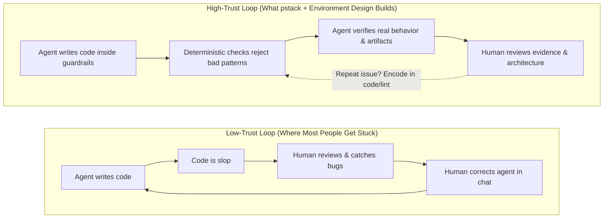
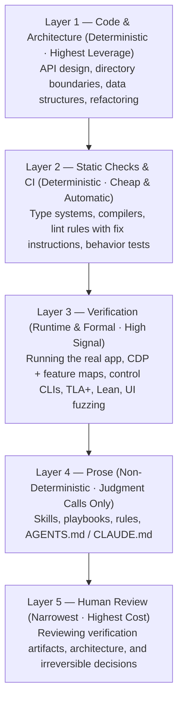
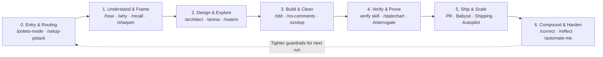
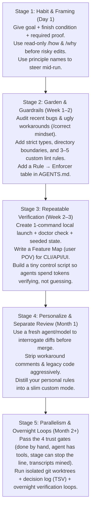

# `pstack` Deep-Dive & Solo Adaptation Guide

> **Scope:** Complete architectural and philosophical guide to [`pstack/`](../../pstack) (`v0.15.46`), synthesized with Lauren Tan's AI Engineer CODE 2026 talk [*"All Code Is Slop (Except Mine)"*](https://www.youtube.com/watch?v=O_zcc6Xl12g), and tailored for a **solo developer** building across **CLI, backend, and web/app** surfaces using a **mix of AI coding harnesses** (Cursor, Claude Code, Antigravity, Codex).

---

## 1. Executive Overview: What Is `pstack`?

**`pstack`** (short for *poteto stack*) is an open-source, MIT-licensed collection of agent workflows, engineering principles, playbooks, subagents, and executable verification tools created by **Lauren Tan** (`@poteto`, Principal Engineer on Grok Bot at SpaceXSI, formerly Meta / React Compiler core team, Netflix, and Cursor).

Its motto—**"if you want to go fast, go deep first"**—captures its core purpose: `pstack` is **not** a prompt pack for generating more lines of code faster. It is an engineering operating system designed to turn AI coding agents from "slop generators" that require constant human babysitting into **disciplined, self-verifying engineers** whose output you can trust and parallelize.

### At a Glance (`v0.15.46` in This Repository)

| Component | Count | Source Path |
|---|---|---|
| **Workflow & Utility Skills** | 34 | [`pstack/skills/`](../../pstack/skills) (non-`principle-*`) |
| **Engineering Principle Skills** | 24 | [`pstack/skills/principle-*/SKILL.md`](../../pstack/skills) |
| **Task Playbooks** | 22 | [`pstack/skills/poteto-mode/playbooks/`](../../pstack/skills/poteto-mode/playbooks) |
| **Specialized Subagents** | 2 | [`pstack/agents/`](../../pstack/agents) (`poteto-agent`, `comment-sicko`) |
| **Bundled Executable Tools** | 4 toolkits | `statechart` (TLA+ → Mermaid compiler), `watch-pr` (PR watcher CLI), `worktree-audit.sh`, `show-me-your-work/scripts/log.sh` |
| **User Guide & Harness Docs** | 12 docs | [`pstack/docs/guide/`](../../pstack/docs/guide/README.md) (10 chapters + index) & [`docs/harness/claude-code.md`](../../pstack/docs/harness/claude-code.md) |
| **Dormant Automation Pack** | 1 pack (2 flows) | [`pstack/automations/benny/`](../../pstack/automations/benny/README.md) |
| **Total Files in `pstack/`** | 553 | 410 files belong to the `statechart` TypeScript compiler + test corpus; 143 files form the rest of the plugin |

---

## 2. The Core Philosophy: *"All Code Is Slop (Except Mine)"*

To understand *why* `pstack` is built the way it is—and how to adapt its philosophy without cargo-culting its files—you have to start with Lauren Tan's November 2026 talk [*"All Code Is Slop (Except Mine)"*](https://www.youtube.com/watch?v=O_zcc6Xl12g).

### 2.1 The Shift: From Writing Throughput to Verifiable Trust

Before coding agents, high PR volume belonged to rare outliers. With agents, anyone can generate thousands of lines of code a day—so **the meta-job of software engineering has shifted to maintaining or improving code quality while scaling output by orders of magnitude**.

The difference between teams drowning in AI slop and teams shipping reliably at high velocity comes down to which feedback loop they operate in:



### 2.2 The Inverse Pyramid of Trust

When an agent repeats a mistake, the instinctive reaction is to add another bullet point to `AGENTS.md` or `CLAUDE.md`. Lauren Tan argues that prose is actually the **weakest** layer of defense. Instead, invest your effort according to an **Inverse Pyramid of Trust**—putting the most weight into wide, cheap, deterministic layers at the top, and reserving narrow, expensive layers at the bottom strictly for judgment:



**The Golden Rule of Corrections** (encoded directly into [`/correct`](../../pstack/skills/correct/SKILL.md) and [`principle-encode-lessons-in-structure`](../../pstack/skills/principle-encode-lessons-in-structure/SKILL.md)):
> *Before adding a line to your agent rules, ask whether a lint rule or test can reject the mistake automatically. Before adding a lint rule, ask whether a better API or architecture can make the invalid choice impossible to write.*

### 2.3 "Codebase as a Garden": Why Old Tech Debt Multiplies Slop

Agents generate outputs from their inputs, and **your repository is the agent's largest input**. An agent usually sees only the files it opens and mimics the nearest pattern it finds:

- **Workarounds spread like weeds.** In the talk, Lauren traced a real incident from Cursor: an architectural clash between VS Code's imperative style and React's declarative style led an agent on **Sep 9** to patch a UI flicker with a `setTimeout` and a comment justifying why a proper fix was too big. By **Oct 3**, another agent copied the pattern into a shared module. By **Oct 17**, the codebase had **183 timers**, causing major GC pauses and UI jank.
- **Comments act as permission slips.** Agents use prose (comments, docs, `eslint-disable` explanations) to rationalize skipping hard root-cause fixes. Worse, comments go stale and cannot fail a build. On Grok Bot, Lauren's team eliminated ~99% of comments (**65,824 → 1,227**), replacing "please don't do X" comments with lint rules whose error messages explain the real architectural fix.
- **Concrete architectural fences from Dune (their Electron framework):**
  1. **Ban nuanced footguns in product code:** React's `useEffect` was banned in ordinary product code and allowed only inside narrow framework internals—categorically removing an entire class of review comments.
  2. **Encode architecture in directory names:** Top-level `electron-main/`, `electron-renderer/`, and `shared/` directories paired with a dependency-graph analyzer and lint rules that forbid cross-process imports (even type imports). Directory names communicate context to the agent; static checks enforce it.

### 2.4 Verification as the New Code Review

When Lauren reviewed 3 PRs/day in 2024, reading every line of diff worked. At 300 PRs/day, human line-by-line code reading becomes the bottleneck. The answer is not reading faster—it is **shifting review to verification evidence** and spending the majority of tokens on proving correctness:

- **~70% of daily tokens go to verification** (corroborating Cindy Sridharan's breakdown: ~20–30% generation, ~70% verification).
- **Four verification layers** discussed in the talk and embodied in `pstack`:

| Verification Layer | What It Proves | Tools Mentioned in Talk | Matching `pstack` Skill(s) |
|---|---|---|---|
| **Runtime Verification** | Real app behavior from the user's POV | Chrome DevTools Protocol (CDP), feature maps, reusable control CLIs | [`/create-verification-skill`](../../pstack/skills/create-verification-skill/SKILL.md), [`/maintain-verification-skill`](../../pstack/skills/maintain-verification-skill/SKILL.md) |
| **Model Checking** | Concurrent & multi-step flows never violate invariants | **TLA+** (e.g., cross-device notifications) | [`/create-formal-verification-skill`](../../pstack/skills/create-formal-verification-skill/SKILL.md), [`/statechart`](../../pstack/skills/statechart/SKILL.md) |
| **Formal Proofs** | Algorithmic invariants hold for all sizes/inputs | **Lean** (e.g., custom list virtualization without flicker/jitter) | [`/create-formal-verification-skill`](../../pstack/skills/create-formal-verification-skill/SKILL.md), [`/maintain-formal-verification-skill`](../../pstack/skills/maintain-formal-verification-skill/SKILL.md) |
| **Property-Based UI Fuzzing** | Unexpected interaction sequences don't crash or break UI invariants | **Bombadil** (UI property-based testing) | [`/swarm`](../../pstack/skills/swarm/SKILL.md) + verification harness |

### 2.5 Reading the Talk's Results Honestly & Ordering Your Work

Lauren reported shipping ~3,000 PRs/month individually (~11,000/month across 227 contributors on Grok Bot, cutting daily stable releases) with a relative revert rate holding around **~0.5%**, and major latency drops (cold launch −39%, long-chat median typing −65%) alongside real tradeoffs shown transparently on her slide (idle memory +12%, window resize +130%, startup JS/CSS bundle +285%).

> [!IMPORTANT]
> **Foundations before software factories:** Her closing warning is the single most important takeaway for solo developers: *"If your inner coding loop produces slop, automating that loop just produces more slop and burns more tokens."* Build the deterministic inner loop and verification harness **first**; only add autonomous outer loops afterward.

---

## 3. Physical Directory Architecture of `pstack/`

Before categorizing `pstack` conceptually, here is how [`pstack/`](../../pstack) is physically laid out on disk:

```text
cursor-plugins/
├── pstack/                                  # Canonical plugin source (v0.15.46)
│   ├── plugin.json                          # Agent plugin manifest (schema v1.0.0)
│   ├── .cursor-plugin/plugin.json           # Cursor marketplace metadata
│   ├── README.md                            # Complete index of playbooks, skills, principles
│   ├── LICENSE                              # MIT
│   ├── assets/logo.png                      # Marketplace icon
│   ├── agents/                              # 2 specialized subagent definitions
│   │   ├── poteto-agent.md                  # Delegate worker (reads poteto-mode + principles first)
│   │   └── comment-sicko.md                 # Adversarial comment & workaround hunter
│   ├── docs/
│   │   ├── guide/                           # 10-chapter practical handbook (01-setup → 10-recipes)
│   │   │   ├── README.md
│   │   │   ├── 01-setup.md … 10-recipes-and-pitfalls.md
│   │   │   └── images/                      # 6 conceptual illustrations
│   │   └── harness/
│   │       └── claude-code.md               # Translation table: Cursor → Claude Code tools/models/paths
│   ├── automations/
│   │   └── benny/                           # Dormant Cursor Automations pack (Slack triage → repro/fix)
│   │       ├── FOR_AGENTS.md, README.md
│   │       ├── skills/                      # setup-benny, triage-issue-reports, reproduce-and-fix-issues
│   │       └── templates/                   # YAML config + automation prompts
│   └── skills/                              # 58 skill directories (34 workflow + 24 principle-*)
│       ├── poteto-mode/                     # Central orchestrator
│       │   ├── SKILL.md                     # Non-negotiables, inline principle index, model routing
│       │   ├── worker.md                    # Contract injected into every spawned worker/subagent
│       │   ├── playbooks/                   # 22 step-by-step markdown playbooks
│       │   ├── references/bugbot-triage.md  # Skeptical bot-review triage rules
│       │   └── scripts/                     # Executable TypeScript/shell tools
│       │       ├── watch-pr/                # Tested TS CLI for watching GitHub/Origin PR checks
│       │       ├── bootstrap.ts
│       │       └── worktree-audit.sh        # Safe git worktree & iOS simulator auditor
│       ├── create-verification-skill/
│       │   ├── SKILL.md
│       │   └── references/feature-map-example/   # Worked Notes app (browser + CLI) verification map
│       ├── statechart/
│       │   ├── SKILL.md
│       │   ├── references/render.md
│       │   └── scripts/                     # Full TLA+/TLC → IR → passes → Mermaid compiler + tests
│       ├── show-me-your-work/
│       │   ├── SKILL.md
│       │   ├── references/decision-log-template.tsv
│       │   └── scripts/log.sh               # Append-only decision trail logger
│       ├── typescript-best-practices/
│       │   ├── SKILL.md
│       │   └── references/patterns.md       # Branded types, discriminated unions, boundary parsing
│       ├── poteto-help/
│       │   ├── SKILL.md
│       │   └── references/{prompting,recipes}.md
│       ├── <28 other workflow skills>/SKILL.md
│       └── principle-<24 principles>/SKILL.md
├── harness/pstack/                          # Generated copy for Claude Code marketplace installs
└── scripts/
    ├── check-pstack-docs.mjs                # Deterministic CI guard: checks doc counts, links, models
    └── generate-pstack-harness-trees.mjs    # Syncs pstack/ → harness/pstack/
```

> [!TIP]
> Notice how `pstack` practices its own philosophy: [`scripts/check-pstack-docs.mjs`](../../scripts/check-pstack-docs.mjs) is a 153-line deterministic verifier that parses English number claims (*"twenty-two playbooks"*), slash commands, markdown anchors, and model IDs across `README.md` and `docs/guide/` and fails CI if documentation ever drifts from the directory tree.

---

## 4. Directory Separation by Category — View A: Software Engineering Workflow Steps

On disk, all 58 skills live flat inside `pstack/skills/` (because plugin loaders discover skills at `skills/<name>/SKILL.md`). Conceptually, however, `pstack` is a **7-stage engineering pipeline** orchestrated by `/poteto-mode`.



### Stage 0 — Entry, Routing & Configuration
*Owns the todo list, model-per-role budget, and worker delegation rules.*

| Directory / File | Type | Purpose |
|---|---|---|
| [`skills/poteto-mode/SKILL.md`](../../pstack/skills/poteto-mode/SKILL.md) | Router Skill | Master entry point: restates goal, matches 1 of 22 playbooks, copies steps verbatim into todo list, routes sub-skills, enforces non-negotiables. |
| [`skills/poteto-mode/worker.md`](../../pstack/skills/poteto-mode/worker.md) | Worker Contract | Mandatory first-line read for every spawned subagent/worker (never ask reversible questions, hold the kickoff bar, open PRs ready with structured 40-line body). |
| [`agents/poteto-agent.md`](../../pstack/agents/poteto-agent.md) | Subagent | Delegate wrapper ensuring every fresh subagent reads `poteto-mode` and its principle index rather than drifting like a generic subagent. |
| [`skills/setup-pstack/`](../../pstack/skills/setup-pstack/SKILL.md) | Setup Skill | Detects available models, lets you pick a reasoning budget, and writes `~/.cursor/rules/pstack-models.mdc` (or `~/.claude/rules/pstack-models.md`). |
| [`skills/poteto-help/`](../../pstack/skills/poteto-help/SKILL.md) | Helper Skill | Read-only advisor that recommends the right skill/playbook/principle and drafts a prompt without spending execution tokens. |

---

### Stage 1 — Understand, Investigate & Frame the Problem
*Never edit code until you understand mechanics, history, and real user intent.*

| Directory / File | Type | Purpose |
|---|---|---|
| [`skills/how/`](../../pstack/skills/how/SKILL.md) | Workflow Skill | Walks through how a subsystem actually works at runtime by tracing code paths. |
| [`skills/why/`](../../pstack/skills/why/SKILL.md) | Workflow Skill | Answers *why* something was built a certain way from git history, PRs, and records (not guessing from code); labels inferences vs. citations. |
| [`skills/teach/`](../../pstack/skills/teach/SKILL.md) | Workflow Skill | Combines `/how` + `/why` into a progressive, diagram-by-diagram explanation so you genuinely understand a subsystem. |
| [`skills/recall/`](../../pstack/skills/recall/SKILL.md) | Workflow Skill | Reconstructs recent working context across chat history, live state, and shared records before resuming work. |
| [`skills/in-your-own-words/`](../../pstack/skills/in-your-own-words/SKILL.md) | Workflow Skill | Makes the agent play back your goal and problem statement before writing a line of code—catching misreadings in 1 message. |
| [`skills/sharpen/`](../../pstack/skills/sharpen/SKILL.md) | Workflow Skill | Rewrites your prompt to be *deeper* (expert methods, raw inputs, outside verification check) without executing it yet. |
| [`playbooks/investigation.md`](../../pstack/skills/poteto-mode/playbooks/investigation.md) | Playbook | Read-only codebase/architecture question. |
| [`playbooks/runtime-forensics.md`](../../pstack/skills/poteto-mode/playbooks/runtime-forensics.md) | Playbook | Diagnose live symptoms (memory leaks, idle CPU spins, UI glitches) via instrumentation. |
| [`playbooks/trace-forensics.md`](../../pstack/skills/poteto-mode/playbooks/trace-forensics.md) | Playbook | Diagnose captured profiling artifacts (`.cpuprofile`, Chrome traces, spindumps, heap snapshots). |

---

### Stage 2 — Design, Architect & Explore the Solution Space
*Settle data shapes, boundaries, and empirical forks before locking into one implementation.*

| Directory / File | Type | Purpose |
|---|---|---|
| [`skills/architect/`](../../pstack/skills/architect/SKILL.md) | Workflow Skill | Sketches caller usage, data shapes, types, and module boundaries *before* writing code across function/module boundaries. |
| [`skills/arena/`](../../pstack/skills/arena/SKILL.md) | Multi-Model Skill | Spawns N competing attempts (often across model families) on the *same* brief, selects the best base, and grafts winning ideas from the rest. |
| [`skills/swarm/`](../../pstack/skills/swarm/SKILL.md) | Parallel Skill | Fans out N workers across *different* independent slices (e.g., packages, feature-map checks, race arms) and aggregates one structured report. |
| [`skills/blast-radius/`](../../pstack/skills/blast-radius/SKILL.md) | Analysis Skill | Maps what a "small-looking" change could break beyond its diff, then proves the core safety invariant by running code. |
| [`skills/figure-it-out/`](../../pstack/skills/figure-it-out/SKILL.md) | Meta-Playbook Skill | Designs a custom, auditable, phase-based playbook when no standard playbook fits (e.g., repo-wide migrations or ambiguous overnight tasks). |
| [`playbooks/prototype.md`](../../pstack/skills/poteto-mode/playbooks/prototype.md) | Playbook | Build throwaway runnable prototypes to settle design or empirical choices cheaply instead of debating in prose. |
| [`playbooks/multi-phase-plan.md`](../../pstack/skills/poteto-mode/playbooks/multi-phase-plan.md) | Playbook | Break large efforts into stacked, independently verifiable phases/PRs. |
| [`playbooks/refactoring.md`](../../pstack/skills/poteto-mode/playbooks/refactoring.md) | Playbook | Behavior-preserving structural improvement. |

---

### Stage 3 — Build, Optimize & Clean
*Write minimal, strongly-typed code; strip AI tells, workaround comments, and accidental complexity.*

| Directory / File | Type | Purpose |
|---|---|---|
| [`skills/tdd/`](../../pstack/skills/tdd/SKILL.md) | Workflow Skill | Red-green TDD strictly when there is a cheap local test path (skips brittle mock-heavy setups). |
| [`skills/typescript-best-practices/`](../../pstack/skills/typescript-best-practices/SKILL.md) | Language Skill | Grounds `type-system-discipline` in concrete TS syntax (`references/patterns.md`: branded types, exhaustive unions, boundary parsing). |
| [`skills/no-comments/`](../../pstack/skills/no-comments/SKILL.md) + [`agents/comment-sicko.md`](../../pstack/agents/comment-sicko.md) | Cleanup Skill + Subagent | Spawns read-only adversarial **Comment Sicko** to hunt narration/workaround comments and unsafe lint suppressions, flags root-cause refactors (`MUST KILL`), and proposes encoding claimed constraints as types/lints/tests. |
| [`skills/unslop/`](../../pstack/skills/unslop/SKILL.md) | Prose Skill | Strips AI writing tells (filler, long dashes, puffed transitions) from replies, docs, and PR descriptions. |
| [`skills/technical-writing/`](../../pstack/skills/technical-writing/SKILL.md) | Prose Skill | Layered doc standard (Diátaxis + Google Developer Style + Simplified Technical English + Global English) for READMEs, RFCs, PRs, commits. |
| [`playbooks/feature.md`](../../pstack/skills/poteto-mode/playbooks/feature.md) | Playbook | End-to-end feature implementation starting from a named data shape. |
| [`playbooks/bug-fix.md`](../../pstack/skills/poteto-mode/playbooks/bug-fix.md) | Playbook | Reproduce first, trace root cause, fix, and prove with runtime evidence. |
| [`playbooks/perf-issue.md`](../../pstack/skills/poteto-mode/playbooks/perf-issue.md) | Playbook | Profile a measured slowness and prove improvement against baseline. |
| [`playbooks/hillclimb.md`](../../pstack/skills/poteto-mode/playbooks/hillclimb.md) | Playbook | Scientific metric-optimization loop (hypothesis → measure → keep/discard → 1 commit per win). |
| [`playbooks/visual-parity.md`](../../pstack/skills/poteto-mode/playbooks/visual-parity.md) | Playbook | Pixel-exact UI equivalence verified via screenshot diffs against a frozen baseline. |

---

### Stage 4 — Verify, Interrogate & Formally Prove
*The heart of Lauren Tan's talk: "it compiles" is never proof. Spend tokens proving real behavior.*

| Directory / File | Type | Purpose |
|---|---|---|
| [`skills/create-verification-skill/`](../../pstack/skills/create-verification-skill/SKILL.md) | Generator Skill | Interviews your repo and generates a project-local `verify-<app>` skill (Launch, Doctor, Drive, Evidence, Cleanup) + user-POV **Feature Map** (`references/feature-map-example/`), proving it end-to-end once before handoff. |
| [`skills/maintain-verification-skill/`](../../pstack/skills/maintain-verification-skill/SKILL.md) | Maintenance Skill | Periodic audit: parallel source readers per feature + 1 live session driving all mapped features; reports product regressions rather than hiding them. |
| [`skills/create-formal-verification-skill/`](../../pstack/skills/create-formal-verification-skill/SKILL.md) | Formal Skill | Targets high-cost bugs tests rarely reach (races, retries, leases, parsers, state machines) using TLA+, Lean, or code verifiers; proves the check actually fails on a broken mutation. |
| [`skills/maintain-formal-verification-skill/`](../../pstack/skills/maintain-formal-verification-skill/SKILL.md) | Formal Maintenance | Re-syncs formal models/harnesses after code commits and distinguishes model drift from real bugs. |
| [`skills/statechart/`](../../pstack/skills/statechart/SKILL.md) | Formal + Visual Tool | Runs TLC on a TLA+ spec via its bundled TypeScript compiler (`scripts/`) and renders a human-readable Mermaid statechart highlighting invariant-breaking states and shortest bug paths—then replays bug paths on real code. |
| [`skills/benchmark-checklist/`](../../pstack/skills/benchmark-checklist/SKILL.md) | Quantitative Skill | 7-question scientific audit (limiter, prod tuning, physical limits, errors, alternating repeat runs, end-to-end relevance, timed-region proof) returning faster / slower / no difference / inconclusive. |
| [`skills/interrogate/`](../../pstack/skills/interrogate/SKILL.md) | Adversarial Review | Multi-model panel tries to break a diff, keeping *only* findings proven by running code or concrete reproduction (eliminates noisy nitpicks). |

---

### Stage 5 — Ship, Audit, Catch-Up & Autonomous Loops
*Separate author from verifier; leave an auditable decision trail; scale cleanly across worktrees.*

| Directory / File | Type | Purpose |
|---|---|---|
| [`skills/show-me-your-work/`](../../pstack/skills/show-me-your-work/SKILL.md) | Audit Trail Skill | Logs one TSV row per decision (`scripts/log.sh`: time, phase, decision, reason, evidence pointer, result); spawns a cross-model reviewer to highlight items needing human attention. |
| [`skills/ketchup/`](../../pstack/skills/ketchup/SKILL.md) & [`skills/ketchup-video/`](../../pstack/skills/ketchup-video/SKILL.md) | Catch-up Skills | Read-only summary of everything that changed while you stepped away (text/visuals or short subtitled slide video), listing every pending decision with pick, evidence, and risk. |
| [`skills/bro/`](../../pstack/skills/bro/SKILL.md) | Translation Skill | Restates dense technical output in plain, jargon-free human speech. |
| [`playbooks/opening-a-pr.md`](../../pstack/skills/poteto-mode/playbooks/opening-a-pr.md) | Playbook | Worktree hygiene, small ordered commits, Conventional Commits title, concise briefing-style body with evidence. |
| [`playbooks/babysit.md`](../../pstack/skills/poteto-mode/playbooks/babysit.md) + `scripts/watch-pr/` | Playbook + CLI | Watches PR checks/threads, resolves blockers in order (conflicts → skeptical thread triage → CI), stops at merge-ready without auto-merging. |
| [`playbooks/shipping.md`](../../pstack/skills/poteto-mode/playbooks/shipping.md) | Playbook | Independent fresh-agent verification per PR (never author = verifier), then merges contiguous verified stack bottom-up. |
| [`playbooks/autonomous-run.md`](../../pstack/skills/poteto-mode/playbooks/autonomous-run.md), [`autopilot-stack.md`](../../pstack/skills/poteto-mode/playbooks/autopilot-stack.md), [`autopilot-full.md`](../../pstack/skills/poteto-mode/playbooks/autopilot-full.md) | Autonomy Playbooks | Overnight single-task loops, multi-PR verified stacks (human merges), or full autonomous verified-and-merged queues. |
| [`playbooks/pause-safely.md`](../../pstack/skills/poteto-mode/playbooks/pause-safely.md), [`session-pickup.md`](../../pstack/skills/poteto-mode/playbooks/session-pickup.md), [`worktree-cleanup.md`](../../pstack/skills/poteto-mode/playbooks/worktree-cleanup.md) | Lifecycle Playbooks | Clean WIP checkpointing, handing off across fresh chats, and reclaiming disk via `scripts/worktree-audit.sh`. |
| [`automations/benny/`](../../pstack/automations/benny/README.md) | Automation Pack | Event-driven outer loop (Slack issue triage → live reproduction & draft fix with UI proof). Cursor-only. |

---

### Stage 6 — Compound, Harden & Personalize
*Turn recurring pain into permanent structural improvements and personalized workflows.*

| Directory / File | Type | Purpose |
|---|---|---|
| [`skills/correct/`](../../pstack/skills/correct/SKILL.md) | Environment Hardening | Mines commits, reverts, PR reviews, and workaround comments for repeat mistake classes (≥2 occurrences); fixes each at the highest Pyramid layer (Architecture → Types/Lint/CI → Test → Docs) and maintains a rule-vs-enforcer table. |
| [`skills/reflect/`](../../pstack/skills/reflect/SKILL.md) | Session Meta-Skill | Mines the current transcript for durable workflow lessons and proposes targeted edits to existing skills (waiting for approval). |
| [`skills/automate-me/`](../../pstack/skills/automate-me/SKILL.md) | Personalization Skill | Mines your recent workspace transcripts to draft your own `<your-name>-mode/SKILL.md` riding on top of `pstack`'s playbooks. |
| [`skills/make-bot-ui/`](../../pstack/skills/make-bot-ui/SKILL.md) | Niche Utility | Builds a lightweight local/Tailscale web UI whose buttons trigger Grok Bot webhooks safely. |
| [`playbooks/authoring-a-skill.md`](../../pstack/skills/poteto-mode/playbooks/authoring-a-skill.md) & [`playbooks/eval.md`](../../pstack/skills/poteto-mode/playbooks/eval.md) | Meta Playbooks | Disciplined skill authoring + blinded A/B evaluation (defeating the observer effect) to prove a skill edit actually improves agent behavior. |

---

## 5. Directory Separation by Category — View B: The 24 Software Engineering Principles

Rather than invoking `principle-*` skills as slash commands, `pstack` stores each engineering philosophy as its own atomic directory (`skills/principle-<name>/SKILL.md`). `/poteto-mode` indexes all 24 inline at task start, and **you use their exact names as 3-word steering levers mid-conversation** (e.g., *"apply subtract before you add"* or *"apply prove it works"*). Every time an agent cites a principle in its reply, it must name the **concrete decision that principle changed**.

### Category 1: Core Design & Problem-Solving (10 Principles)
*How to think before coding, cut bloat, and avoid local maxima.*

| Directory (`skills/...`) | Principle | Core Philosophy & Trigger |
|---|---|---|
| [`principle-laziness-protocol`](../../pstack/skills/principle-laziness-protocol/SKILL.md) | **Laziness Protocol** | Bias toward deletion and the smallest change that solves the problem; resist premature abstractions, wrappers, and flag-threading. |
| [`principle-foundational-thinking`](../../pstack/skills/principle-foundational-thinking/SKILL.md) | **Foundational Thinking** | Get core types, data structures, and concurrency ownership right *before* writing logic so downstream code becomes obvious. |
| [`principle-redesign-from-first-principles`](../../pstack/skills/principle-redesign-from-first-principles/SKILL.md) | **Redesign from First Principles** | When adding a new requirement, reshape the design as if that requirement had been foundational from day one instead of bolting it on. |
| [`principle-attack-the-premise`](../../pstack/skills/principle-attack-the-premise/SKILL.md) | **Attack the Premise** | When 2+ fixes sharing one assumption fail the same gate, stop patching—write the premise down and test the premise directly. |
| [`principle-subtract-before-you-add`](../../pstack/skills/principle-subtract-before-you-add/SKILL.md) | **Subtract Before You Add** | Delete dead code, obsolete adapters, and redundant validators *first*, then build on the cleaner base. |
| [`principle-minimize-reader-load`](../../pstack/skills/principle-minimize-reader-load/SKILL.md) | **Minimize Reader Load** | Count indirection layers and hidden mutable state a reader must track; collapse one-caller wrappers and shrink mutable scope. |
| [`principle-outcome-oriented-execution`](../../pstack/skills/principle-outcome-oriented-execution/SKILL.md) | **Outcome-Oriented Execution** | During planned rewrites/migrations, converge directly on the target architecture instead of building throwaway compatibility shims. |
| [`principle-experience-first`](../../pstack/skills/principle-experience-first/SKILL.md) | **Experience First** | Choose user delight over implementation convenience; ship fewer polished capabilities over more rough ones. |
| [`principle-exhaust-the-design-space`](../../pstack/skills/principle-exhaust-the-design-space/SKILL.md) | **Exhaust the Design Space** | For novel UX or architectural choices without precedent, build 2–3 competing prototypes and compare side-by-side before committing. |
| [`principle-build-the-lever`](../../pstack/skills/principle-build-the-lever/SKILL.md) | **Build the Lever** | For repeatable edits, analyses, or checks, write the deterministic tool (codemod, script, control CLI, generator) instead of doing it manually. |

### Category 2: Architecture & Correctness by Construction (6 Principles)
*Where state, validation, boundaries, and concurrency invariants live.*

| Directory (`skills/...`) | Principle | Core Philosophy & Trigger |
|---|---|---|
| [`principle-model-the-domain`](../../pstack/skills/principle-model-the-domain/SKILL.md) | **Model the Domain** | Replace scattered conditionals and repeated shape assumptions with an explicit structure (state machine, reducer, registry, typed table). |
| [`principle-boundary-discipline`](../../pstack/skills/principle-boundary-discipline/SKILL.md) | **Boundary Discipline** | Validate and handle untrusted data at system boundaries (CLI args, env/config, HTTP/DB/external APIs); trust internal types and keep core logic pure. |
| [`principle-type-system-discipline`](../../pstack/skills/principle-type-system-discipline/SKILL.md) | **Type System Discipline** | Make illegal states unrepresentable, brand semantic primitives (`UserId` vs `string`), parse at boundaries, exhaust union variants, derive types from authoritative schemas. |
| [`principle-make-operations-idempotent`](../../pstack/skills/principle-make-operations-idempotent/SKILL.md) | **Make Operations Idempotent** | Design CLI commands, migrations, jobs, and lifecycle loops to converge cleanly on the same end state across crashes and retries. |
| [`principle-migrate-callers-then-delete-legacy-apis`](../../pstack/skills/principle-migrate-callers-then-delete-legacy-apis/SKILL.md) | **Migrate Callers Then Delete Legacy APIs** | Migrate all callers and delete the old internal API in the same wave—never leave deprecated patterns around for the next agent to copy. |
| [`principle-separate-before-serializing-shared-state`](../../pstack/skills/principle-separate-before-serializing-shared-state/SKILL.md) | **Separate Before Serializing Shared State** | When concurrent actors (or parallel agents) touch the same file/branch/state, eliminate sharing first (e.g., separate worktrees/data dirs) before adding locks. |

### Category 3: Verification, Root Cause & Scientific Rigor (5 Principles)
*What counts as proof—and how to avoid fooling yourself.*

| Directory (`skills/...`) | Principle | Core Philosophy & Trigger |
|---|---|---|
| [`principle-prove-it-works`](../../pstack/skills/principle-prove-it-works/SKILL.md) | **Prove It Works** | Verify against the real artifact (run the CLI, walk the UI, query back the DB row, inspect the diff). "It compiles" or self-reports never count. |
| [`principle-fix-root-causes`](../../pstack/skills/principle-fix-root-causes/SKILL.md) | **Fix Root Causes** | Trace every symptom to the *first* point the system went wrong and fix it there. A defensive guard is only a real fix when that state is legitimate. |
| [`principle-sequence-verifiable-units`](../../pstack/skills/principle-sequence-verifiable-units/SKILL.md) | **Sequence Work into Verifiable Units** | Decompose multi-step work into small atomic units that each end in a runnable check, ordered so each commit/PR proves itself. |
| [`principle-test-behavior-not-implementation`](../../pstack/skills/principle-test-behavior-not-implementation/SKILL.md) | **Test Behavior, Not Implementation** | Assert externally observable behavior so tests catch real regressions and survive internal refactoring. |
| [`principle-explain-the-number`](../../pstack/skills/principle-explain-the-number/SKILL.md) | **Explain the Number** | Before trusting or reporting a benchmark/speedup, identify its physical limiter and rule out measurement artifacts (warm caches, debug builds, skipped work). |

### Category 4: Delegation, Context & Autonomy (2 Principles)
*How to run multi-agent work without losing signal or getting bogged down in permission prompts.*

| Directory (`skills/...`) | Principle | Core Philosophy & Trigger |
|---|---|---|
| [`principle-guard-the-context-window`](../../pstack/skills/principle-guard-the-context-window/SKILL.md) | **Guard the Context Window** | Route bulky reading, log scanning, and parallel sweeps to fresh subagents; keep only concise, verified summaries in the coordinator thread. |
| [`principle-never-block-on-the-human`](../../pstack/skills/principle-never-block-on-the-human/SKILL.md) | **Never Block on the Human** | On reversible decisions, proceed with your best judgment and present the result; reserve human pauses strictly for irreversible actions (deploys, data deletion, force-pushes, external messages). |

### Category 5: Meta-Engineering (1 Principle)
*The compounding flywheel that connects `pstack` directly to Lauren Tan's talk.*

| Directory (`skills/...`) | Principle | Core Philosophy & Trigger |
|---|---|---|
| [`principle-encode-lessons-in-structure`](../../pstack/skills/principle-encode-lessons-in-structure/SKILL.md) | **Encode Lessons in Structure** | The second time you repeat an instruction or correction, turn it into architecture, types, a lint rule, a runtime check, or a CI script—not more prompt text. |

---

## 6. Adapting `pstack` as a Solo Developer (CLI + Backend + Web/App)

Being a **solo developer** changes the economics of `pstack` in your favor:
- **No team politics or legacy compatibility overhead:** You can delete dead APIs immediately (`migrate-callers-then-delete-legacy-apis`), enforce clean directory boundaries on day one, and keep your garden spotless.
- **Your #1 bottleneck is cognitive switching across 3 surfaces (CLI, backend, web/app):** Without automated verification and guardrails, every time you switch from backend to UI or CLI, subtle regressions slip in and you become your own manual QA team.

### 6.1 Surface-by-Surface Trust Pyramid Blueprint

Here is how to apply the Inverse Pyramid of Trust across all three surfaces you build:

| Pyramid Layer | CLI Projects | Backend Services / APIs | Web & App Frontends |
|---|---|---|---|
| **1. Architecture & Boundaries** | Strict split: `cli/` (arg parsing, formatting, exit codes) → `core/` (pure domain logic) → `io/` (fs/network). Zero business logic in command handlers. | Strict layered directories: `routes/` (transport & auth) → `domain/` (pure logic & state machines) → `repos/` (DB/external I/O). Never call DB clients directly from routes. | Clear separation: `ui/` (presentational components) vs. `features/` (workflows) vs. `client/` (API/state) vs. `shared/` (types/schemas). Restrict error-prone hooks/side effects to dedicated primitives. |
| **2. Deterministic Static Checks** | Strict types + schema-validated CLI flags (`zod`/clap/pydantic), lint banning raw `console.log` inside `core/`, snapshot/contract tests for `--help` and `--format json`. | Schema-first types (OpenAPI/Zod/SQLc/Prisma), lint rules forbidding cross-layer imports (ESLint `no-restricted-imports`, `dependency-cruiser`, ArchUnit, Go `internal/`), migration checks in CI. | Strict TypeScript (`noUncheckedIndexedAccess`, exhaustive switches), import boundary lint, comment/suppression hygiene (ban `@ts-ignore` and workaround `eslint-disable` without issue/expiry), bundle/perf budgets. |
| **3. Runtime & Formal Verification** | Run the **actual built binary** in a disposable temp dir; assert stdout, stderr, exit code, and machine-readable `--format json`; support `--dry-run` on destructive commands. | One-command disposable seeded environment (Docker/SQLite/testcontainers); hit real HTTP/RPC endpoints; **read back persisted state** from a second endpoint/query; test idempotency under retries. Add **TLA+ / `/statechart`** only for critical state machines (payments, auth sessions, job queues, sync). | Build a project-local `verify-<app>` skill + **Feature Map** (see [`feature-map-example/`](../../pstack/skills/create-verification-skill/references/feature-map-example/README.md)); drive via Playwright/CDP using **ARIA roles** (never brittle CSS selectors); capture before/after screenshots or video; verify persistence across page reloads. |
| **4. Control Lever (`Build the Lever`)** | Consistent `--format json`, rich `--help`, actionable error messages that tell agents what flag to pass next. | Seed/reset/inspect CLI (e.g., `devctl seed`, `devctl doctor`, `devctl db-inspect`) so agents don't write throwaway scripts every session. | Tiny `control-<app>` wrapper CLI (`doctor`, `browser click/fill/snapshot/screenshot`, `cli -- ...`) that keeps token cost low and works identically across all AI harnesses. |

### 6.2 What to Keep vs. Skip as a Solo Developer

You do **not** need all 58 skills on day one. As [`09-make-it-yours.md`](../../pstack/docs/guide/09-make-it-yours.md) emphasizes: *"Start smaller than you think."*

- **Adopt immediately (Highest ROI for solo devs):**
  1. **Goal + Checkable Finish Condition prompting:** Tell the agent *what done looks like* and *what evidence to show*, not step-by-step micromanagement.
  2. **`/correct` discipline (`encode-lessons-in-structure`):** Whenever you correct an agent twice for the same issue, stop and turn it into a type, boundary lint rule, or script. Maintain a small **Rule → Enforcer** table in your repo's `AGENTS.md`.
  3. **Project-local verification + Feature Map (`/create-verification-skill`):** Especially powerful when one app has both a web UI and a CLI/API (just like `pstack`'s bundled `Notes` example!).
  4. **The 24 Principle Names as Steering Vocabulary:** Keep the short list handy—typing *"apply subtract before you add"* or *"apply prove it works"* fixes agent drift in one sentence.
  5. **Fresh Subagents + Worktree Isolation:** Never run two parallel coding sessions in the same working tree; separate author from verifier (`interrogate` / fresh review pass).
  6. **Workaround-Comment Hygiene (`/no-comments` spirit):** You don't have to ban *all* helpful docstrings, but ruthlessly kill comments that excuse hacks, `setTimeout` band-aids, or suppressed lint/type errors—fix the root cause instead.
- **Adopt selectively (When your project hits the trigger):**
  - **`/architect` & `/prototype`:** Use whenever a design crosses module boundaries or has genuine UX/architecture uncertainty.
  - **`/benchmark-checklist` & `hillclimb`:** Use whenever optimizing latency, throughput, or bundle size.
  - **`/create-formal-verification-skill` & `/statechart`:** Use selectively on high-consequence concurrent or stateful flows (offline sync, billing webhooks, distributed locks, job leases)—skip for ordinary CRUD.
  - **`/show-me-your-work` & overnight `/loop`:** Only after your verification script reliably catches broken changes on its own.
- **Skip (or defer) for solo work:**
  - **`automations/benny/`** (designed for team Slack issue triage on Cursor Automations).
  - **`/make-bot-ui`** (Grok Bot webhook specific).
  - **Heavy `autopilot-full` auto-merging** until your CI + runtime verification suite is rock-solid; prefer **`autopilot-stack`** (agents build & verify PRs/branches, you review evidence and merge).

### 6.3 The 5-Stage Solo Rollout Ladder



---

## 7. Multi-Harness Adaptation Strategy (Cursor + Claude Code + Antigravity + Codex)

Because you use a **mix of AI coding tools**, the worst mistake you can make is maintaining four divergent copies of prompts, rules, and custom slash commands.

### 7.1 The Key Insight: Repo-First Portability

Look back at the Inverse Pyramid of Trust:
- **Layers 1, 2, and 3 (Codebase architecture, Types/Lint/CI, Verification CLIs & Feature Maps) are 100% harness-agnostic.** Cursor, Claude Code, Antigravity, and Codex can *all* run `npm run lint`, `pytest`, `./scripts/verify doctor`, and read `docs/verification/features/*.md`.
- Only **Layer 4 (Prose/Skills/Subagent syntax)** varies by harness—and Layer 4 is intentionally the *thinnest* layer!

### 7.2 Canonical Repo Layout for Multi-Harness Solo Projects

Structure each of your projects so every harness points to the **exact same canonical files**:

```text
your-project/
├── AGENTS.md                        # Canonical repo handbook (short! includes Rule → Enforcer table)
├── CLAUDE.md                        # 1-line pointer: "Read AGENTS.md first." (or symlink)
├── .cursor/rules/project.mdc        # Thin wrapper pointing to AGENTS.md (if using Cursor)
├── scripts/
│   ├── check-architecture.*         # Boundary/import/doc drift checks (inspired by check-pstack-docs.mjs)
│   └── verify-ctl                   # Single reusable verification CLI (doctor, seed, run, snapshot, cleanup)
└── docs/
    └── verification/
        ├── README.md                # Baseline preconditions, launch, doctor, cleanup, proof rules
        └── features/                # User-POV feature maps (CLI + API + UI recipes)
```

### 7.3 Cross-Harness Feature Mapping Table

Based on [`pstack/docs/harness/claude-code.md`](../../pstack/docs/harness/claude-code.md) and each tool's native primitives, here is how `pstack` concepts translate cleanly across all four harnesses:

| `pstack` Concept | Cursor (Native) | Claude Code | Antigravity | Codex CLI / App |
|---|---|---|---|---|
| **Install / Load `pstack`** | `/add-plugin pstack` | `/plugin marketplace add cursor/plugins` → `/plugin install pstack@cursor-plugins` (uses `harness/pstack/`) | Import selected skills via `SKILL.md` or reference repo `AGENTS.md` + custom skills | Load via repo `AGENTS.md` + local skills directory |
| **Always-On Repo Rules** | `.cursor/rules/*.mdc` | `CLAUDE.md` / `~/.claude/rules/*.md` | Workspace `AGENTS.md` + saved Skills | `AGENTS.md` (hierarchical per directory) |
| **Slash Invocation** | `/poteto-mode`, `/correct`, etc. (Option/Alt+Enter for sticky mode) | `/pstack:poteto-mode`, `/pstack:correct` | Custom skills (`lookup_skill`) + `/plan`, `/goal`, `/grill-me`, `/teamwork` | Prompt prefix referencing skill/playbook file |
| **Fresh Subagents & Isolation** | `Task` (`poteto-agent`, `run_in_background`, cloud/worktree) | `Agent` (`pstack:poteto-agent`, `isolation: "worktree"`) | `invoke_subagent` (`self` / `research` / custom `define_subagent`) | Parallel git worktrees / background tasks |
| **Model Diversity (Panels / Review)** | `~/.cursor/rules/pstack-models.mdc` via `/setup-pstack` | `~/.claude/rules/pstack-models.md` (Claude families; omit non-Claude slugs) | Invoke subagents or cross-check diffs in a second harness (e.g., author in Claude/Codex, interrogate in Cursor/Antigravity) | Cross-check diffs by running a second harness on the same branch/diff |
| **PR / Git Forge Automation** | Built-in PR tools + `watch-pr` + Bugbot | `gh` CLI + `watch-pr` (skips Cursor Automations / Bugbot start) | `gh` CLI + `watch-pr` + verification scripts | `gh` CLI + `watch-pr` |
| **Overnight / Long Loops** | `/poteto-mode` + `/loop` + Cursor Projects | Autonomous run playbook + shell loop / `show-me-your-work` TSV | `/goal` or `/teamwork` + checkable finish condition + `decisions.tsv` | Headless loop script checking explicit pass/fail predicate |

> [!TIP]
> **Multi-harness superpower for solo devs:** Since you already use multiple harnesses, you get **`/interrogate` and `/arena` model diversity for free**—even without Cursor's multi-model slug routing! For high-stakes architecture or pre-merge review, author the implementation in one harness (e.g., Claude Code or Cursor), then open a fresh session in another harness (e.g., Antigravity or Codex) with a single prompt: *"Interrogate `git diff main` skeptically. Keep only bugs or regressions you can prove by running code."*

### 7.4 The Rule → Enforcer Table Pattern (From `/correct`)

Put a compact table like this inside your project's `AGENTS.md`. Any row whose **Enforced By** column says `prose only` is a debt item waiting to be promoted up the Trust Pyramid the next time an agent violates it:

| Rule | Why It Matters | Enforced By | Level |
|---|---|---|---|
| No DB client imports inside `routes/` | Keeps HTTP transport decoupled from storage; prevents N+1 leaks | ESLint `no-restricted-imports` / `scripts/check-arch` | Layer 2 (Lint) |
| All CLI commands support `--format json` | Makes CLI outputs verifiable by agents without fragile regexes | Contract test in `tests/cli-contract.test.ts` | Layer 2 (Test) |
| Never leave `@ts-ignore` or workaround comments | Prevents copy-pasted slop & hides root causes | Lint rule + pre-merge `/no-comments` pass | Layer 2 (Lint) |
| UI mutations must survive a full reload | Proves real persistence, not just optimistic local state | `docs/verification/features/*.md` + `verify-ctl` | Layer 3 (Runtime) |
| Keep docs/counts synced with directory tree | Prevents stale agent context | `scripts/check-docs` in CI | Layer 2 (CI) |

---

## 8. Quick Reference: High-Signal Prompt Recipes for Your Solo Workflow

1. **Before touching an unfamiliar or tangled area (Understand first):**
   > *"Trace how `<subsystem>` works end-to-end (`/how`), then check git history for why it was shaped this way (`/why`). Don't edit code yet."*
2. **When starting a feature or refactor across CLI + backend + web:**
   > *"Goal: `<user outcome>`. Name the core data shape and boundary types first before writing logic. Done means: `<exact CLI command / API read-back / UI flow>` passes and shows real evidence."*
3. **When an agent repeats a mistake a second time (`/correct`):**
   > *"You made `<mistake>` again. Don't add a note to `AGENTS.md`. Encode a deterministic check (architecture, type, lint with an actionable error message, or behavior test), prove it fails on the buggy code, and update our Rule → Enforcer table."*
4. **When building your project's verification lever:**
   > *"Inspect this repo and create a project-local verification guide (`docs/verification/`) with Launch, Doctor, Drive, Evidence, Cleanup sections plus a user-POV Feature Map covering our CLI, API, and UI flows. Prove one feature end-to-end and verify proof artifacts survive cleanup."*
5. **When you want an honest, noise-free review before merging:**
   > *"Interrogate `git diff main` skeptically. Ignore style nitpicks. Report only real bugs, regressions, or broken invariants that you can prove by running code."*
