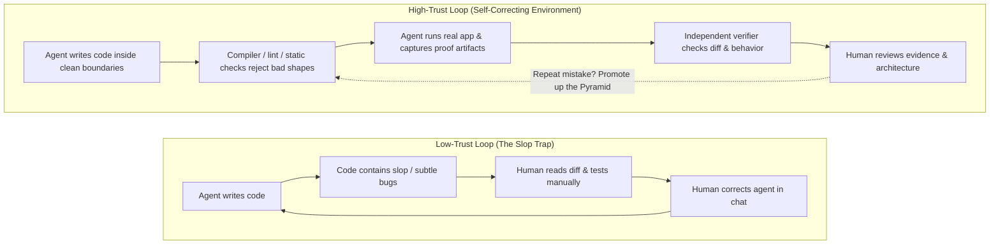
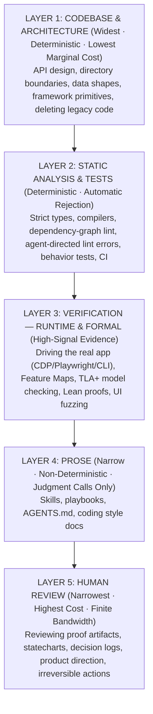

# 01. The Inverse Pyramid of Trust

> **Core Thesis:** *"The meta-job of software engineering is no longer writing code faster—it is figuring out how to maintain or improve code quality while massively increasing output. That is not about blind trust in agents; it is about investing in the agent's environment until you have objective reasons to trust what comes out."*

---

## 1. The Productivity Inversion: Why Old Habits Break

In 2024, Lauren Tan walked into work and reviewed roughly **3 pull requests a day** written by human colleagues. By late 2026, that number was closer to **300 pull requests a day** generated by fleets of coding agents.

Before coding agents, software engineering operated under one binding constraint: **human typing and thinking throughput**. Only rare outliers ("coding machines" like Bret Taylor rewriting Google Maps in a weekend) could out-produce a team. Code review existed as a human safety net because human output was slow enough for another human to read every line.

AI agents collapsed that constraint overnight. Suddenly, **anyone can produce thousands of lines of code a day**. When production volume increases 100×, the bottleneck moves ruthlessly to two new places:

1. **Verifiable Trust** — knowing whether a change actually works and obeys system invariants without reading every line by hand.
2. **Environment Quality** — ensuring the codebase itself guides agents toward good patterns rather than multiplying bad ones.

### The Low-Trust Loop vs. The High-Trust Loop

Most engineers adopting coding agents get trapped in what Lauren calls the **Low-Trust Loop**:



In the Low-Trust Loop, **you become a human go-between**—or, in Lauren's memorable phrase from optimizing Cursor's Agent pane, **"the meat proxy between my agent and Chrome DevTools."** She realized she was launching the app herself, reading flame graphs and heap snapshots, typing her observations into chat, waiting for the agent to edit code, and then re-running the profiler herself.

As long as you are the eyes, hands, and memory of the loop, **running 5 parallel agents does not make you 5× faster—it gives you 5× as many interruptions waiting for your attention.**

---

## 2. The Inverse Pyramid of Trust

When an agent makes a mistake for the third time, almost every developer has the same reflex: open `AGENTS.md` (or `CLAUDE.md` or `.cursor/rules`) and add one more warning sentence—*"NEVER import the database client inside an API route!"*

Lauren Tan argues this instinct is completely upside down. **Prose is the weakest enforcement mechanism in software engineering.** Instead, she models where to invest engineering effort as an **Inverse Pyramid of Trust**:



### Why the Pyramid Is Inverted

Two forces run in opposite directions as you move down the pyramid:

| Property | Top (Layers 1–2: Code & Static Checks) | Middle (Layer 3: Verification) | Bottom (Layers 4–5: Prose & Human Review) |
|---|---|---|---|
| **Determinism** | **100% deterministic.** Gives the exact same answer on every run, every model, every harness. | **Empirical / Formal.** Proves actual behavior or mathematical invariants. | **Probabilistic.** An agent can ignore a prose rule when context fills up; humans get tired. |
| **Feedback Speed** | **Milliseconds to seconds.** Agent hits a wall and self-corrects inside the same turn. | **Seconds to minutes.** Catches behavioral, visual, and concurrency bugs before merge. | **Minutes to hours.** Blocks asynchronously on human attention. |
| **Marginal Cost per PR** | **Near zero** once built. Scales effortlessly from 1 PR/day to 1,000 PRs/day. | **Token + compute cost** (~70% of daily tokens), completely scalable with machines. | **Human attention** — strictly capped and non-scalable. |
| **Cross-Harness Portability** | **100% portable** across Cursor, Claude Code, Antigravity, Codex, and human contributors. | **100% portable** when wrapped in repo scripts/CLIs. | **Tool-specific** and prone to drifting across harnesses. |

> **The Golden Rule of Corrections (`Encode Lessons in Structure`):**
> *Before adding another line to `AGENTS.md`, ask whether a lint rule or test can reject the mistake mechanically. Before adding a lint rule, ask whether a better API, type, or directory design can make the mistake impossible to write in the first place.*

---

## 3. Concrete Walkthrough: Solving the Same Bug at All 5 Layers

To see the Inverse Pyramid in action, take a classic recurring bug in backend web/API projects: **an agent adds a new admin endpoint and forgets to enforce tenant/organization authorization, querying the database directly by `recordId`.**

Watch what happens when you handle that repeat mistake at each layer of the pyramid:

### Level 5 — Human Review (Most Expensive, Never Compounds)
You spot the missing tenant check during code review and leave a comment: *"Please scope this query by `orgId`!"*
- **Outcome:** Fixed in *this* PR. Next Tuesday, a fresh agent writes another route and makes the exact same mistake.

### Level 4 — Prose in `AGENTS.md` (Fragile, Unenforceable)
You add a bold warning to `AGENTS.md`:
> *"CRITICAL: Always filter every database query by `ctx.orgId`!"*
- **Outcome:** Works 70% of the time. When a chat gets long or an agent opens a file that doesn't show the pattern, it forgets. Nothing fails when the rule is skipped.

### Level 3 — Behavioral / Runtime Verification (High Signal, Catches Before Merge)
You write a cross-tenant integration test / verification script that creates `Org A` and `Org B`, attempts to fetch `Org A`'s record with `Org B`'s token, and asserts HTTP `403`/`404`.
- **Outcome:** Catches the leak if the endpoint is wired into the test suite—but a brand-new endpoint might still ship untested if the agent forgets to add it to the suite.

### Level 2 — Static Analysis & Lint (Automatic, Instant Feedback)
You add a dependency-graph lint rule forbidding `src/routes/**` from importing `src/io/rawDb`—with an **agent-directed error message**:
```text
error: Routes cannot import 'src/io/rawDb' directly.
Use a tenant-scoped repository from 'src/io/repos/' (see 'src/io/repos/projects.ts')
which requires a verified TenantContext.
```
- **Outcome:** The instant any agent tries to query the DB directly from a route, the linter rejects it and points straight to the right module. The agent fixes itself in 5 seconds.

### Level 1 — Codebase Architecture & Types (Impossible to Write Wrong)
You redesign the data-access API so `rawDb` is unexported/private to `src/io/tenantDb.ts`, and the **only** exported function requires an authenticated `TenantContext` branded at the auth middleware boundary:

```ts
// Only auth middleware can construct a verified TenantContext
export type TenantContext = { readonly orgId: OrgId; readonly __brand: "TenantContext" };

// Every query helper automatically injects WHERE org_id = ctx.orgId
export function findProject(ctx: TenantContext, id: ProjectId): Promise<Project | null> {
  return rawDb.projects.findFirst({ where: { id, orgId: ctx.orgId } });
}
```

- **Outcome:** It is now **physically impossible** for any agent (or human) to call `findProject` without a verified `TenantContext`. You never review for missing tenant filters again—and you can **delete** the warning from `AGENTS.md`!

---

## 4. The Autonomy Boundary: Verifiability × Reversibility

A natural question—pressed directly by Matt Pocock in his interview with Lauren Tan—is: *"How far can you push this? Is autonomous merging safe for finance, healthcare, or destructive database migrations?"*

Lauren's answer separates two orthogonal axes that many developers conflate:

1. **Verifiability:** Can a machine programmatically check whether the change achieved its goal without regressions?
2. **Reversibility ("Two-Way Door" vs. "One-Way Door"):** If a subtle mistake slips through anyway, can you revert it cleanly in 60 seconds, or is data/money/trust permanently damaged?

```mermaid
quadrantChart
    title Autonomy Readiness Matrix
    x-axis Low Verifiability --> High Verifiability
    y-axis Irreversible (One-Way Door) --> Reversible (Two-Way Door)
    quadrant-1 High Autonomy Safe (UI fixes, refactors, perf, CLI features)
    quadrant-2 Human Judgment Needed (UX taste, ambiguous product direction)
    quadrant-3 Always Human-Led (Strategy, breaking public APIs, security policy)
    quadrant-4 Verify Heavily + Human Merge Gate (DB migrations, billing, auth, deploys)
```

Notice the critical insight in Quadrant 4: **a passing test suite proves assertions passed; it will not recover dropped production rows.** That is why even in `pstack`'s own autonomy rules (*Never Block on the Human*), irreversible actions—deploys, data deletion, force-pushes to shared branches, external customer messages—**always** require explicit human confirmation.

---

## 5. Honest Reading of Lauren Tan's Reported Outcomes

In *"All Code Is Slop (Except Mine)"*, Lauren shared her team's real production metrics on Grok Bot (an Electron desktop app) across five months:

- **PR volume:** Rose from 809/month (June) to **10,926/month** (October) across 227 contributors (~3,000+/month personally). She explicitly notes in interviews that a huge fraction of those PRs are **gardening** (restructuring, deleting dead patterns, hardening guardrails), *not* 3,000 net-new user features.
- **Revert rate:** Held steady around **~0.5%** on a relative basis even as volume grew 13×.
- **User-facing latency (May → Nov):** Cold launch −39% (`2,304 → 1,395 ms`), long-chat median typing latency −65% (`8.4 → 2.9 ms`), chat switching −40% to −44%.
- **Honest regressions shown on the same slide:** Idle memory rose +12% (`488 → 545 MiB`), window resize latency rose +130% (`3.0 → 6.9 ms`), and startup JS/CSS bundle grew +285% (`2.0 → 7.7 MB`).

**The transferable takeaway is not the raw PR count—it is the order of operations:**
1. Clean the codebase agents read from (Layer 1).
2. Make recurring corrections executable via types and lint (Layer 2).
3. Build real runtime/formal verification so agents prove behavior (Layer 3).
4. **Only then** scale parallelism and outer-loop automation (Layers 4–5).

---

**Next Article:** [02. Codebase as a Garden & Local-Context Architecture](./02-codebase-as-a-garden.md) →
