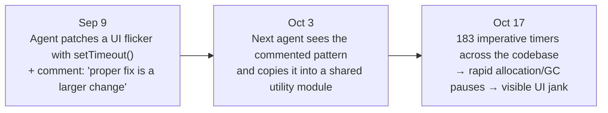

# 02. Codebase as a Garden & Local-Context Architecture

> **The Axiom:** *"Assume every contributor is an agent that sees only the files it opened, copies the nearest example, and takes the shortest path that compiles. Design the repo so a change that looks right from one file is right for the whole repo."*

---

## 1. Why Your Codebase Is Your Largest Prompt

Developers obsess over crafting the perfect 500-line system prompt while ignoring a far larger input sitting right in front of the model: **the repository itself**.

When an agent opens three files to implement a feature, 95% of its context window is your existing code. If your repository contains:
- Two competing ways to fetch data,
- A deprecated state store kept around "just in case,"
- A hacky `setTimeout` workaround with a polite comment explaining why it was necessary,
- Or an 8,000-line "god file" where everything gets appended,

then **every new agent assumes those patterns are the house style and faithfully reproduces them**.

Lauren Tan compares an agent-driven codebase to a **garden**:
- Code no longer arrives a few carefully pruned branches a week; it arrives like fast-growing organic vines.
- Your architecture, directory structure, and static guardrails are the **concrete trellis** that new growth climbs around.
- Leftover workarounds and deprecated APIs are **weeds**. In a human-only repo, weeds sit quietly in a corner. In an agent-assisted repo, **weeds pollinate every new PR at machine speed**.

---

## 2. Two Real-World Case Studies From Lauren Tan's Work

### Case Study A: From Eight 10,000-Line God Files to Dune

Early versions of Grok Bot consisted of roughly **eight massive files exceeding 10,000 lines each**. Whenever an agent was asked to add a feature, the path of least resistance was obvious: append another block of logic to the nearest giant file. Prompting agents to "please modularize" failed repeatedly because without explicit conventions, every task forced the agent to invent an architecture from scratch.

Her team's fix was **Dune**—an internal desktop framework she describes as *"Next.js for Electron apps."* Dune wasn't technically exotic; its superpower was **making structure unavoidable**:

1. **Feature-per-directory with standardized discovery:** Every feature lives in its own folder and hooks into the app through one blessed registration mechanism. An agent never wonders *"where does this new feature go?"*
2. **Context encoded directly in top-level directory names:** In Electron apps (including Cursor), agents constantly imported main-process Node code into the UI renderer thread, stalling the UI with long tasks. Dune eliminated the ambiguity with three explicit top-level directories:
   ```text
   electron-renderer/   # UI only (features/, client/, primitives/)
   electron-main/       # Main process only (startup/, notifications/, update/)
   shared/              # Pure types & contracts shared by both sides
   ```
   A dependency-graph analyzer forbids imports across `electron-main/` and `electron-renderer/`—**not even type imports**. The directory name teaches the architecture; static analysis enforces it.
3. **Banning nuanced footguns locally:** React's `useEffect` has legitimate uses, *"but people joke you need a PhD to use it properly"*—and agents misuse it constantly (infinite render loops, stale closures, race conditions). Dune banned `useEffect` outright in ordinary product code, allowing it only inside narrow, audited framework primitives. An entire category of PR bugs vanished permanently.

### Case Study B: How One Workaround Became 183 Timers in Five Weeks

At Cursor, an underlying architectural clash existed between VS Code's imperative style and React's declarative style. Look at how a single tiny compromise mutated into a product-wide performance crisis:



Notice the lesson: **an architectural mismatch doesn't just make the runtime slower—it makes every agent worse**, because agents reach for timers and hacks to paper over the clash, and then copy each other's hacks.

---

## 3. Five Architectural Principles That Keep the Garden Clean

Drawn directly from `pstack`'s core & architecture principles, these five habits turn a repository into an environment where agents naturally produce clean code.

### 3.1 Subtract Before You Add & Delete Legacy APIs in One Wave
*Principles: `Subtract Before You Add` + `Migrate Callers Then Delete Legacy APIs` + `Outcome-Oriented Execution`*

When introducing a new pattern or refactoring an old one, human teams often keep the old helper around for "gradual migration." In an agent-assisted codebase—especially a **solo** one with no external backward-compatibility promises—**coexisting old and new APIs are poison**.

- **Rule:** Sequence **removal before construction**. Delete dead code, obsolete adapters, and speculative validators *first*, then build on the smaller base.
- **Rule:** Migrate all callers and delete the old internal API in the **same wave/PR**. Leave zero deprecated examples for the next agent to imitate.
- **Rule (`Outcome-Oriented Execution`):** During planned rewrites with clear phase boundaries, converge straight on the target architecture rather than writing throwaway compatibility shims that harden into permanent debt.

**Example (Backend Repository Migration):**
```ts
// BAD: Leaving v1 alongside v2 so agents randomly copy v1 next week
export function getUserLegacy(id: string) { /* ... */ } // @deprecated use fetchUser
export function fetchUser(ctx: TenantContext, id: UserId) { /* ... */ }

// GOOD: Migrate every caller in one sweep, delete getUserLegacy, and let the compiler verify 0 callers remain.
```

### 3.2 One Owner, One Way
*Principles: `Foundational Thinking` + `Laziness Protocol` + `/architect`*

Before writing code that crosses a function or module boundary, sketch **two competing shapes** and pick the one where:
1. **Each piece of state has exactly one owner.** Never maintain two hand-synced lists, two caches, or mirrored config files.
2. **Each task has exactly one supported way.** One HTTP client, one logger, one error format, one way to register a CLI subcommand.
3. **"DRY the structure, not every line."** Consolidating decisions behind one source of truth beats abstracting three similar lines into a generic helper full of boolean flags.

### 3.3 Minimize Reader Load (The 30-Second Agent Test)
*Principle: `Minimize Reader Load`*

Reader load is the mental effort required to trace code—and **it hurts LLM reasoning just as much as human comprehension**. It has two independent axes:

1. **Layers of indirection** between a question and its answer.
2. **Hidden or mutable state** that must be held in working memory.

| High Reader Load (Agent Confusion) | Low Reader Load (Agent Clarity) |
|---|---|
| `Route → Controller → Service → Manager → Repository → DB` (5 pass-through layers with 1 caller each) | `Route (parse + auth) → Domain pure fn → Repository (query)` — collapse one-caller wrappers! |
| Shared module-level mutable cache mutated by 4 helpers | Return new values; prefer `returns > locals > fields > module state > globals`. Derive instead of sync. |
| Re-checking `if (!user)` in 6 internal helpers | Validate once at the boundary; trust the internal type everywhere else. |

> **The 30-Second Test:** Open any file cold. Can a new reader (or an agent with 1–2 files open) answer **"Where does `X` come from?"** and **"What can change `X`?"** in under 30 seconds? If not, collapse layers or shrink mutable scope.

### 3.4 Redesign From First Principles (Refusing Bolt-On Flags)
*Principle: `Redesign From First Principles`*

When a new requirement arrives, an agent's default move is to bolt an optional parameter or `if (mode === "special")` branch onto an existing function. Three features later, the function is an unmaintainable tangle.

Instead, pause and ask: **"If we were designing this module from scratch knowing this requirement existed on day one, what would the data shape look like?"**

```ts
// BOLTED ON: 3 features added as optional flags -> 8 possible combinations, half invalid
function exportData(rows: Row[], asJson?: boolean, pretty?: boolean, includeHeaders?: boolean) { ... }

// REDESIGNED FROM FIRST PRINCIPLES: Explicit format union -> every state is valid & self-documenting
type ExportFormat =
  | { kind: "csv"; includeHeaders: boolean }
  | { kind: "json"; pretty: boolean };

function exportData(rows: Row[], format: ExportFormat): string { ... }
```

### 3.5 Ban Your Local Footguns (The Dune Pattern for Solo Repos)

You don't need to copy SpaceXSI's exact Electron bans—you need to copy **the method**. Every stack has 2–4 nuanced APIs that agents repeatedly misuse:

| Surface | Nuanced Footguns Agents Misuse | Narrow Blessed Primitive to Provide Instead |
|---|---|---|
| **Web / React** | Raw `useEffect` for data fetching/sync; scattered `setTimeout` / `requestAnimationFrame` | Dedicated query hooks (`useQuery`), declarative transitions, or one audited timer hook |
| **Backend / API** | Raw SQL string interpolation; direct DB client imports in HTTP handlers; un-timed `fetch()` | Typed repository module requiring `TenantContext`; shared `httpClient` with timeout + retry budget |
| **CLI** | Scattered `process.exit()` and `console.log()` deep in logic; non-atomic `fs.writeFileSync` | Pure command functions returning structured `Result`; single renderer for text/`--format json`; atomic `writeFileAtomic()` helper |

Put the safe primitive in one file, delete every raw call site, and enforce the ban at Layer 2 so the footgun can never return.

---

**Previous:** ← [01. The Inverse Pyramid of Trust](./01-inverse-pyramid-of-trust.md) | **Next:** [03. Types, Boundaries & Domain Modeling](./03-types-boundaries-and-domain-modeling.md) →
