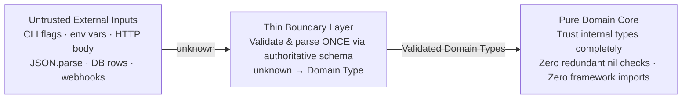

# 03. Types, Boundaries & Domain Modeling

> **Core Philosophy:** *"Encode the domain in a data structure instead of scattering it across conditionals. The right structure makes invalid states unrepresentable and deletes branches."*

---

## 1. Why Type Systems Matter 10× More With AI Agents

A strict type system used to be viewed mainly as documentation and refactoring safety for human teams. With AI agents, a strong type system becomes something far more powerful: **a real-time formal constraint solver that narrows the space of programs the agent is allowed to generate.**

When types are loose (`string`, `any`, optional-property bags), an agent can write plausible-looking code that compiles cleanly and fails subtly at runtime. When types are tight, every mistake produces an immediate compiler diagnostic in milliseconds—before a single test or human review runs.

---

## 2. Model the Domain: Data Structures Delete Branches

*Principle: `Model the Domain` + `Foundational Thinking`*

The unmistakable smell that a module skipped domain modeling is **a feature that adds one more `if/else` branch, or a second boolean flag that must stay in sync with the first.**

### Example 1: Replacing Boolean Bags With a Discriminated State Machine (Web / Async UI)

```ts
// SLOP: 2^3 = 8 combinations of booleans + optionals.
// Nothing stops { isLoading: true, data: [...], error: "Timeout" } from existing.
type FetchState<T> = {
  isLoading: boolean;
  data?: T;
  error?: string;
  retried?: boolean;
};

// MODELED DOMAIN: Only the 4 valid states can ever exist.
type FetchState<T> =
  | { kind: "idle" }
  | { kind: "loading"; attempt: number }
  | { kind: "ready"; data: T }
  | { kind: "failed"; error: string; retryable: boolean };
```

Now every consumer uses an **exhaustive `switch`** with a `never` check:

```ts
function renderStatus<T>(state: FetchState<T>): string {
  switch (state.kind) {
    case "idle":
      return "Ready";
    case "loading":
      return `Loading (attempt ${state.attempt})...`;
    case "ready":
      return "Loaded";
    case "failed":
      return state.retryable ? `Retrying: ${state.error}` : `Error: ${state.error}`;
    default: {
      const _exhaustive: never = state;
      return _exhaustive;
    }
  }
}
```

If an agent later adds `{ kind: "stale"; data: T; refreshing: boolean }`, **every single switch statement across the entire codebase fails to compile** until the agent handles `"stale"` explicitly. The compiler becomes a repo-wide checklist that cannot be forgotten.

### Example 2: Registries & Tables Over Scattered Conditionals (CLI / Backend)

Instead of repeating `if (cmd === "sync") ... else if (cmd === "prune") ...` across help text, argument validation, telemetry, and execution—define **one typed registry**:

```ts
const COMMANDS = {
  sync:  { description: "Sync remote records", destructive: false, run: runSync },
  prune: { description: "Delete stale cache",  destructive: true,  run: runPrune },
} as const satisfies Record<string, CommandSpec>;

type CommandName = keyof typeof COMMANDS; // Derived automatically — zero drift
```

Notice `satisfies`: it validates every entry against `CommandSpec` *without* widening `COMMANDS` into a generic `Record<string, CommandSpec>`, preserving literal keys for `CommandName`.

---

## 3. Constructive Modeling vs. Defensive Guards

*Principle: `Type System Discipline` + `typescript-best-practices`*

Most developers write a loose type and then scatter runtime `if` checks or comments promising an invariant. **Constructive modeling builds the shape out of parts that are all legal**, so the illegal value cannot even be constructed.

| Invariant Held by Comment or Runtime Guard (Fragile) | Constructive Type (Illegal State Unconstructable) |
|---|---|
| `type TimeRange = { start: Date; end: Date }; // start <= end` | `type TimeRange = { start: Date; durationMs: NonNegativeMs };` (derive `rangeEnd()` as a pure helper) |
| `function pickWinner(xs: string[]) { if (!xs.length) throw ... }` | `type NonEmpty<T> = [T, ...T[]];` → `function pickWinner(xs: NonEmpty<string>)` |
| `function pairUp(xs: string[]) { if (xs.length % 2) throw ... }` | `type Pairs<T> = [T, T][];` (derive `.flat()` when flat output is needed) |
| `function transfer(from: string, to: string, amount: number)` | `function transfer(args: { from: AccountId; to: AccountId; cents: PositiveCents })` |

### Branded Semantic Primitives

Whenever two values share the same underlying primitive (`string` or `number`) but mean different things—such as `UserId` vs. `OrgId`, `FilePath` vs. `Url`, or `Milliseconds` vs. `Seconds`—brand them so swapping arguments fails to compile:

```ts
type UserId = string & { readonly __brand: "UserId" };
type OrgId  = string & { readonly __brand: "OrgId" };

// A brand is created ONLY by a verifying parser/guard — NEVER via `as UserId` at random call sites.
function parseUserId(input: unknown): UserId {
  if (typeof input !== "string" || !/^usr_[a-z0-9]+$/.test(input)) {
    throw new Error(`Invalid UserId: ${String(input)}`);
  }
  return input as UserId;
}
```

### The Anti-Overengineering Safeguard: "Simplest Total Type"

A common mistake after learning constructive modeling is over-typing *everything*. `pstack` encodes an explicit counterweight called **Simplest Total Type**:

- Keep plain `T[]` whenever every operation on it is already total (for example, `sum(xs: number[])` returns `0` for `[]`—no guard needed).
- Strengthen to `NonEmpty<T>` or a branded type **only when the looser type forces a lie at a call site**.
- **The three tells that a type is too loose:**
  1. Non-null assertions (`sessions.at(0)!`)
  2. Unsafe casts (`arr[0] as Session`)
  3. `"should never happen"` throws inside internal code

When you see one of those three tells, strengthen the input type (or widen the return type to `T | undefined`) until the lie disappears.

---

## 4. Boundary Discipline: Parse Once, Trust Inside

*Principle: `Boundary Discipline`*

Agents frequently clutter internal business logic with paranoid checks (`if (!user || !user.email) ...`) while simultaneously trusting raw `JSON.parse()` output via `as User` at the HTTP boundary—the exact opposite of sound engineering.

**Boundary Discipline** draws a bright wall between the untrusted outside world and your pure internal core:



### The Two-Question Filter

Whenever you (or an agent) are about to add validation or error handling, ask two questions:
1. **Is this data crossing a system boundary right now?** If not, the validation is redundant—trust the internal type.
2. **Can this be a pure function that the shell just calls?** If yes, extract it out of the CLI/HTTP/React wrapper into pure domain logic.

### Schemas Before Hand-Rolled Guards (and Bidirectional Verification)

Never maintain three separate copies of a shape (a schema, a TypeScript interface, and a manual type guard)—they *will* drift apart.

1. **Schema-first (Preferred):** Derive the static type directly from your runtime schema (`z.infer<typeof UserSchema>`, OpenAPI codegen, Protobuf, SQLc, Pydantic).
2. **Type-first (When an interface already exists):** Annotate the runtime validator with the type it claims to prove:
   ```ts
   type User = { id: string; name: string };
   // If someone adds a field to User or drops one from the schema, THIS FAILS TO COMPILE:
   const UserSchema: z.ZodType<User> = z.object({ id: z.string(), name: z.string() });
   ```
3. **Never write a lying type guard:** A guard like `function isUser(x: unknown): x is User { return typeof x === "object" && x !== null && "id" in x; }` is **worse than `as`**, because it hides an unverified assumption behind a function name that claims safety.

---

## 5. Correctness Over Time: Idempotency & State Isolation

Two architectural principles in `pstack` prevent the nastiest class of backend, CLI, and multi-agent bugs—crashes mid-run and concurrent writes.

### 5.1 Make Operations Idempotent
*Principle: `Make Operations Idempotent`*

CLI commands, setup scripts, database migrations, webhook handlers, and background workers *will* crash halfway through and get retried.

- **Reconcile from actual state, not prior intent:** Read what currently exists on disk/DB, compare it to the desired goal, and apply only the diff.
- **Make partial artifacts recognizable as stale:** Anything left behind by a crashed run (a lockfile, temp file, half-written record, claimed job) must be detectable as stale on the next run.
- **Write-then-rename for files:** Always write to `<target>.tmp.<pid>` and atomically `rename()` into place so readers never observe half-written JSON/config files.
- **The litmus test:** *"What happens if this runs twice? What if the previous run crashed right before every single I/O line?"*

### 5.2 Separate Before Serializing Shared State
*Principle: `Separate Before Serializing Shared State`*

When multiple processes, jobs, or parallel AI agents might write to the same file, database row, or git branch, the knee-jerk reaction is *"let's add a lock / mutex."*

`pstack` flips that default: **"We need a lock" is a design smell to check first.**

- Ask whether the actors actually share one invariant or are simply publishing independent facts.
- **Two workers each updating their own key inside one `state.json` is still shared mutation** (race conditions + clobbered writes). Give each worker its own file (`state/<worker-id>.json`), temp data dir (`/tmp/app-verify-$RUN_ID`), or git worktree, and merge only at read time.
- **Instructions are not concurrency control:** Telling two agents in prose *"please don't edit the same file"* fails reliably. Isolate structurally first; serialize with locks/CAS/single-writer queues only when a single shared writer is a genuine domain invariant.

---

**Previous:** ← [02. Codebase as a Garden](./02-codebase-as-a-garden.md) | **Next:** [04. Static Analysis, Agent-Directed Lint & Why Comments Lie](./04-static-analysis-and-anti-comment-hygiene.md) →
