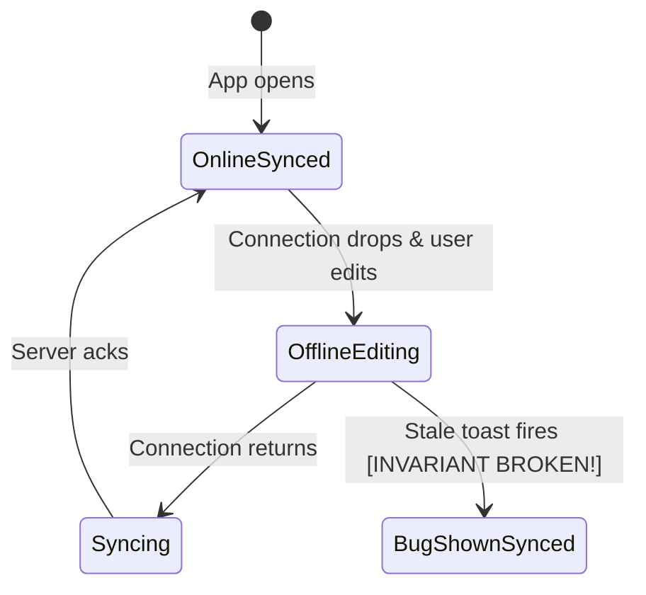

# 05. Verification as the New Code Review

> **Core Philosophy:** *"'It compiles' is not evidence. When agents write code at 100× speed, human line-by-line diff reading stops scaling. The answer is not reading faster—it is spending ~70% of your tokens proving behavior and shifting human review to verification artifacts."*

---

## 1. The Economics of the "Golden Age of Verification"

In *"All Code Is Slop (Except Mine)"*, Lauren Tan cited Cindy Sridharan's observation—confirming it matches her own daily usage: **roughly 70% of daily token spend goes into verifying patches, and only 20–30% into generating them.**

Why? Because **none of the strongest verification techniques in computer science are new**—runtime end-to-end harnesses, Chrome DevTools profiling, property-based UI fuzzing, TLA+ model checking, and Lean formal proofs have existed for years. Historically, they were simply **too expensive to write and maintain by hand** for ordinary product code.

Coding agents flip those economics completely:
- Writing and maintaining verification infrastructure is now cheap.
- Therefore, **you can verify every change far deeper than was ever economical before**—and review **videos, screenshots, traces, benchmark tables, and statecharts** instead of squinting at 800-line diffs.

---

## 2. Defeating Tautological Tests (`Test Behavior, Not Implementation`)

One of the biggest traps when letting agents write tests is what Matt Pocock and Lauren Tan call **tautological tests**: tests that look green and achieve 95% coverage while proving absolutely nothing.

Common causes of tautological agent tests:
- Mocking the exact internal helper doing the work and asserting `expect(mockHelper).toHaveBeenCalledWith(...)`.
- Computing the expected value inside the test using the same helper/formula as the code under test.
- Asserting on fake data the test itself constructed rather than state persisted and read back.

### The Two-Edit Litmus Test

From `pstack`'s `Test Behavior, Not Implementation` principle, judge every single test against **two imagined edits**:

1. **Edit A — Break the real behavior** (return a wrong value, skip a side effect, write duplicate rows).
   - *If the test still passes, it is theater—fix or delete it.*
2. **Edit B — Refactor the internals** while keeping every externally observable output identical.
   - *If the test fails, it is pinned to implementation details—rewrite it against the public interface.*

```ts
// TAUTOLOGICAL (fails Edit B, often survives Edit A):
test("archives project", async () => {
  const spy = vi.spyOn(db, "update").mockResolvedValue({ count: 1 });
  await archiveProject(ctx, projectId);
  expect(spy).toHaveBeenCalledWith("projects", { archived: true });
});

// BEHAVIORAL (catches Edit A, survives Edit B):
test("archived project disappears from active list and appears in archive", async () => {
  const created = await app.post("/projects", { name: "Alpha" });
  await app.post(`/projects/${created.id}/archive`);

  const active   = await app.get("/projects?status=active");
  const archived = await app.get("/projects?status=archived");
  expect(active.items.map(p => p.id)).not.toContain(created.id);
  expect(archived.items.map(p => p.id)).toContain(created.id);
});
```

Additional concrete rules from the principle:
- **Pair "this never happens" with a case where it does happen** (otherwise a no-op passes).
- **Assert the error type/code callers branch on**, not brittle prose error messages.
- **Prove a test fails first** on the broken code or a deliberately broken scratch mutation—*a check you have never seen fail proves nothing.*

---

## 3. Giving Agents "Eyes and Hands" (Runtime Verification)

*Principle: `Prove It Works` + `Build the Lever`*

Match the proof directly to what changed—never accept a proxy (like a green build or file timestamp):

| What Changed | Weak Proxy (Reject!) | Real Proof (Require!) |
|---|---|---|
| **CLI command** | `tsc` passes / unit test with mocked `fs` | Run the actual built binary in a disposable temp dir; capture literal command, `stdout`, `stderr`, exit code, and `--format json`. |
| **Backend / Storage** | HTTP `200 OK` from mocked repo | Start real disposable server + seeded DB; call real endpoint; **read the stored value back via a second independent query**. |
| **Web / App UI** | Component renders in jsdom | Drive the running app via CDP/Playwright using **ARIA roles** (not CSS selectors); capture ARIA snapshot + before/after screenshot/video; reload page to prove persistence. |
| **Parser / Migration** | Unit test on 2 synthetic strings | Replay a saved real-world input corpus / real snapshot and verify invariants. |
| **Performance fix** | "Replaced O(n²) loop with Map" | Before/after profiles or alternating benchmark runs vetted against a limiter. |

### The Six-Part Verification Contract

Lauren Tan calls a project-local verification skill **the single highest-leverage piece of infrastructure in any repo**. Every trustworthy verification harness defines six explicit parts:

1. **Launch:** One deterministic command to start the app in an isolated environment (disposable data dir `APP_DATA_DIR=/tmp/verify-$RUN_ID`, seeded test users/data, known port).
2. **Doctor:** One read-only health check confirming the exact URL, build SHA, and disposable data dir—so an agent never accidentally drives your personal dev database or a stale process.
3. **Feature Map (User POV):** A human- and agent-readable "site map" of the application from the **user's point of view** (not internal file names). Each feature entry has 4 crisp sections:
   - *Sub-features* (IDs + 1-line behaviors)
   - *How to get to it (user POV)* (buttons, keyboard shortcuts, CLI commands)
   - *Driving recipes* (exact literal commands + observable assertions)
   - *Gotchas* (traps that invalidate runs, e.g., *"pressing `n` inside an input types 'n' instead of opening a new note"*)
4. **Evidence:** Explicit rules for what proof to save (screenshots, ARIA snapshots, CLI output, read-back queries) and where to put it.
5. **Cleanup:** Kill only the processes started by this run and clean up fixtures—**without deleting the proof artifacts**.
6. **Helpers (The Control Lever):** A reusable control CLI so agents don't waste tokens writing throwaway Playwright/curl scripts from scratch every session.

### The Mechanical vs. Judgment Split (`Build the Lever`)

Lauren noticed that when she told agents *"verify this in the browser"*, each agent wrote its own fragile throwaway script, spent half its tokens debugging the script, and threw it away.

Her fix is a universal engineering rule: **move every repeatable mechanical step into a tiny, tested CLI; save the LLM strictly for judgment.**

Six traits of an agent-friendly control CLI (applicable to both your verification tools and your own CLI products):
1. **Few composable commands** doing real work (e.g., `verify-ctl doctor`, `verify-ctl browser click --role button --name "Save"`, `verify-ctl cli -- ...`).
2. **`--dry-run`** on anything destructive.
3. **Progressive subcommands** that don't dump 80 flags at once.
4. **Actionable error messages** that tell the agent what to run instead.
5. **Rich `--help`** text.
6. **Machine-readable output (`--format json`)** so agents never parse fragile human tables with regex.

---

## 4. Scientific Rigor for Numbers (`Explain the Number`)

Before trusting or shipping *any* measured number—a speedup, latency drop, memory savings, or eval score—apply `pstack`'s 7-question scientific audit:

1. **Write the decision threshold before you run:** What result would actually change your decision? What is the noise floor? (Stop if run-to-run spread exceeds the claimed effect.)
2. **Ask "Why isn't it double?"** Identify the actual physical or code-path **limiter** from a real profile or hardware/runtime counters—a guess from reading source code does not count.
3. **Verify production tuning:** Did *both* baseline and treatment run with release flags, realistic data sizes, and identical builds?
4. **Sanity-check physical limits:** Does the claimed throughput accidentally exceed disk bandwidth, network latency, or core count (a telltale sign that work was cached or skipped)?
5. **Check for silent errors or wrong output:** Fast wrong answers don't count.
6. **Run alternating trials:** Report run count, **median**, and **spread/range** across alternating baseline/treatment runs (eliminating thermal throttling or warm-cache bias).
7. **Confirm end-to-end relevance & timed-region honesty:** Did the real work actually execute *inside* the timed region (not lazily deferred or memoized), and does it move a path users actually wait on?

If you cannot name the limiter or rule out skipped work, the verdict is **`inconclusive`**—never `"faster."`

---

## 5. Formal Verification & Visual Statecharts: Proving What Tests Never Reach

Runtime tests prove the paths you think to drive. The nastiest bugs in backend, sync, and UI code live on **paths nobody drives**: two retries overlapping, an auth token expiring mid-request, an offline edit colliding with a stale sync, or a list virtualizer oscillating on a rare scroll delta.

Lauren Tan's team layers three formal/property tools on top of runtime verification—not as silver bullets, and not for ordinary CRUD, but for **high-consequence invariants**:

| Technique | Tool Used by Grok Bot | What It Excels At |
|---|---|---|
| **Model Checking** | **TLA+ / TLC** | Exhaustively exploring every possible interleaving of concurrent/multi-step user flows (e.g., notifications across multiple devices, job leases, offline/online sync). |
| **Formal Proofs** | **Lean** | Proving algorithmic invariants hold for *all* inputs/sizes (e.g., their custom list virtualization math never flickers or jitters). |
| **Property-Based UI Fuzzing** | **Bombadil** | Hammering the real UI with generated interaction sequences to verify global invariants (no crashes, no stuck loading spinners, no lost edits). |

### Turning Formal Specs Into Human-Readable Statecharts

The traditional problem with TLA+ is that product owners, designers, and even busy engineers don't want to read raw temporal logic. Lauren's solution was building a compiler (`statechart`) that runs the TLC model checker and compiles the state space into a **Mermaid statechart labeled in plain user terms**:



- **Why this changes code review:** A screenshot proves *one* happy state looked fine. A model-checked statechart shows **every reachable user-visible state**, highlights any state that breaks a user rule (*"you must never see 'Synced' while offline"*), and gives the **shortest step-by-step path** to trigger the bug—which the agent then replays against the real running code to confirm it isn't just a modeling error.
- **Keep formal checks honest:** Record the exact commit SHA each formal model was last synced to, and whenever covered code changes, re-sync and distinguish **model drift** from a **real product bug**.

---

**Previous:** ← [04. Static Analysis & Why Comments Lie](./04-static-analysis-and-anti-comment-hygiene.md) | **Next:** [06. Debugging, Design & Scientific Engineering](./06-debugging-design-and-scientific-thinking.md) →
