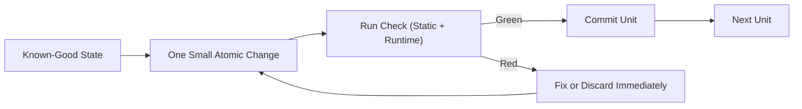
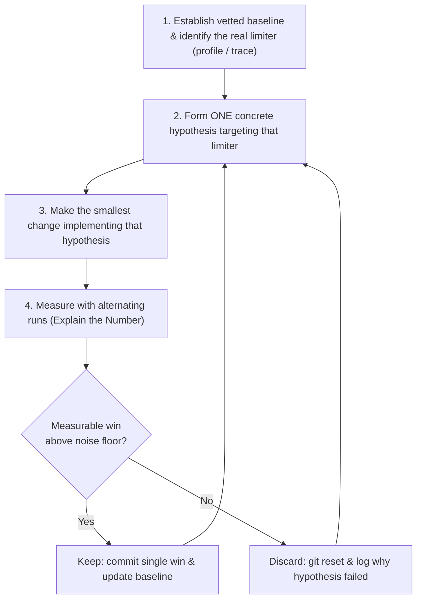

# 06. Debugging, Design & Scientific Engineering

> **Core Philosophy:** *"Fix the fault, not the place where it surfaced. When two or more fixes sharing one premise fail the same gate, stop fixing—test the premise. And when design choices are uncertain, remember: the best spec is running code."*

---

## 1. Fix Root Causes, Never Symptom Guards

*Principle: `Fix Root Causes`*

AI agents—and hurried humans—have a dangerous reflex when debugging: **patch the line that threw the error.** If `user.profile.email` throws `TypeError: Cannot read properties of undefined`, the shortest patch is `user?.profile?.email ?? ""`.

That single line of defensive code is **the seed of architectural rot**.

### The Legitimacy Question

Before adding *any* guard, fallback, retry, clamp, or `try/catch`, ask one razor-sharp question:

> **"Is the state that triggered this symptom legitimate?"**

- **If YES** (e.g., an optional profile field that real users may leave blank): handle it explicitly in the domain model and type signature.
- **If NO** (e.g., an authenticated route somehow received a `user` without a `profile`, even though signup always creates one): **a null guard hides the bug**. Trace backwards until you find the *first* place the system violated the invariant (perhaps a broken migration, a partial write, or a missing transaction) and fix it there.

```ts
// SYMPTOM GUARD (hides corruption and silently sends blank emails):
function sendReceipt(order: Order) {
  if (!order.customer?.email) return; // "fixed" the crash!
  mailer.send(order.customer.email, renderReceipt(order));
}

// ROOT-CAUSE FIX:
// 1. Trace why an Order existed without a customer email (guest checkout skipped validation).
// 2. Enforce email in OrderSchema at the checkout boundary + DB NOT NULL constraint.
// 3. Fix every other checkout entry point with the same fault (fix the pattern, not the instance).
```

Five classic ways agents accidentally hide root causes:
1. Defensive null guards (`?.` / `?? ""`) for impossible states
2. Blind retries (`for (let i = 0; i < 3; i++)`) papering over race conditions
3. Swallowed exceptions (`catch { return null; }`)
4. Clamping out-of-range numbers (`Math.max(0, balance)`) instead of fixing why balance went negative
5. `setTimeout` delays masking un-synchronized state transitions

**Bonus habit:** If finding the root cause required a 30-minute deep dig, ask: *what cheap, always-on signal (assertion, structured log field, or invariant check) would have exposed this in 10 seconds?* Add that signal before moving on.

---

## 2. Attack the Premise: Escaping Retry Loops

*Principle: `Attack the Premise`*

Every developer who works with coding agents has watched the **"Death Spiral"**:
- Attempt 1 fails CI → agent tweaks a regex → Attempt 2 fails the same test → agent adds a sleep → Attempt 3 fails again → agent tries a third workaround...

Why does this happen? Because all three fixes quietly share **one false hidden assumption** (e.g., *"the cache is stale"*, *"the server hasn't started yet"*, *"the parser is misreading UTF-8"*).

`pstack` turns escaping the death spiral into a hard rule:

> **When two or more fixes that share one premise fail the same gate, STOP writing fixes. Write the premise down as a single sentence, and test the premise directly.**

### Worked Example (Backend / CLI Debugging)

Suppose a CLI export intermittently produces truncated JSON on CI.
- **Fix 1 (Failed):** Increased flush timeout before exit.
- **Fix 2 (Failed):** Switched from `console.log` to `process.stdout.write` with callback.
- **Trigger (`Attack the Premise`):** Stop! Both fixes assumed: *"Our CLI process is exiting before stdout finishes flushing."*
- **Direct Discriminating Test:** Log the exact byte count written by the CLI to a temp file *and* compare it against what the parent test harness read from `execSync`.
- **Observation:** The file has 1.4 MB (complete); `execSync` truncated at exactly `1,048,576` bytes—Node's default `maxBuffer`!
- **Lesson:** Look at **how failures are distributed** (exact 1 MiB cliff!), not just how often they happen. Testing the premise took 60 seconds and saved an hour of blind flailing.

---

## 3. Prototypes Over Abstract Plans ("The Best Spec Is Code")

*Principles: `Exhaust the Design Space` + `Experience First` + `Foundational Thinking`*

One of Lauren Tan's strongest engineering opinions—explicitly called out in `pstack`'s README under *"Why are there no planning skills?"*—is:

> **"Personally, I don't believe in abstract planning. The best spec is code."**

Why? Because **adversarial review of an abstract Markdown plan invents hypothetical risks that never happen while missing the real constraints you only discover when code touches reality.**

### When to Prototype Instead of Debating in Prose

1. **Empirical forks:** *"Will a virtualized list handle 50k rows smoothly without layout thrashing?"* Don't debate in 4 paragraphs—spend 3 minutes building a throwaway benchmark/prototype and measure it.
2. **Novel UX / feel decisions (`Exhaust the Design Space`):** *"Which layout feels better for the diff viewer?"* Build **2–3 competing throwaway HTML prototypes** behind a switcher, click through them side by side, pick the winner from lived feel, and throw the prototypes away.
3. **Contested architectures:** Spawn 2–3 competing sketches on the *same* small brief, compare how clean the resulting types and call sites actually look, pick the best base, and graft the strongest ideas from the others.

### Experience First vs. Foundational Thinking (Target vs. Sequence)

Two principles work as a pair so you never build beautiful architecture for the wrong experience—or a slick UI on rotting foundations:

- **`Experience First` governs the TARGET:** Who is the user? For a web app, the end user; for a CLI, the developer typing commands; for an internal library, the engineer (or agent) importing it next month. Ship 3 polished, delightful capabilities over 10 rough ones.
- **`Foundational Thinking` governs the SEQUENCE:** Once you know the target experience, remove dead code first, nail the core data structures and shared types next, scaffold CI/verification early, and *then* build features so every downstream line becomes obvious.

---

## 4. Sequence Work Into Verifiable Units

*Principle: `Sequence Work into Verifiable Units`*

Large, sprawling diffs are where AI agents lose coherence and humans lose the will to review. Whether you are doing a 20-file migration, a multi-surface feature (DB schema → API → CLI → Web UI), or a refactor, structure every step as a **verifiable bracket**:



### Order Delivery So the History Proves Itself

Even as a solo developer, ordering commits cleanly makes `git log`, `git bisect`, and morning audits effortless:

1. **Bug fix:** Commit 1 adds the failing behavioral test (or repro script) → Commit 2 adds the minimal root-cause fix turning it green.
2. **Refactor + Feature:** Commit 1 deletes dead code (*Subtract Before You Add*) → Commit 2 reshapes structure with behavior unchanged → Commit 3 adds the new feature cleanly on top.
3. **Performance work:** Commit 1 adds the repeatable benchmark harness & baseline measurement → Commit 2+ lands **one commit per verified speedup**.

---

## 5. Scientific Hillclimbing (Optimizing Metrics Without Guessing)

When optimizing latency, memory, startup time, bundle size, or accuracy, prompting an agent *"make this faster"* usually produces messy micro-optimizations that add complexity without moving the needle.

Instead, run a **scientific hillclimbing loop**:



Notice the discipline:
- **Changes that don't measurably help get discarded**, never left behind "because they look cleaner."
- **A plateau triggers a pivot** (re-profile to find the *new* bottleneck—or attack the premise), not diminishing-return hacks.
- **Never relax the finish condition** to declare victory early.

---

**Previous:** ← [05. Verification as the New Code Review](./05-verification-as-code-review.md) | **Next:** [07. From Line Cook to Head Chef: Delegation, Intent & Factories](./07-human-in-the-loop-delegation-and-factories.md) →
