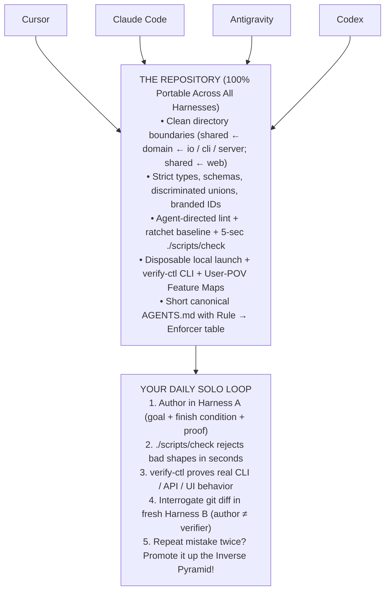

# 07. From Line Cook to Head Chef: Delegation, Intent & Software Factories

> **Core Philosophy:** *"A factory does not rescue a bad process by running it faster. Build a proper Michelin-starred kitchen before opening more restaurants—and once you step back from the stove, remember you are still accountable for every dish that leaves the pass."*

---

## 1. The Michelin-Starred Kitchen Metaphor

In her live interview with Matt Pocock, Lauren Tan offered the cleanest mental model for how a senior software engineer's role evolves in the agent era: **you transition from line cook to head chef.**

- **The Line Cook (Old Model):** Chops every vegetable, cooks every pan, plates every dish personally. Quality is high, but throughput is capped at one pair of hands.
- **The Head Chef (Agent-Era Model):** Does not cook every single dish on the line—instead, designs the **kitchen layout** (architecture & directory boundaries), builds and sharpens the **prep tools** (CLIs, linters, type systems, verification harnesses), sets the **quality standards** (invariants & taste), hires/coordinates the **brigade** (specialized & fresh agents), and **tastes dishes at the pass** (reviews verification artifacts and spot-checks commits for systemic drift).

Crucially, **stepping back from typing code does not reduce accountability**. When a spot-check reveals a flaw, a Head Chef doesn't just re-plate one dish—they ask: *"Which station, prep tool, or standard allowed this mistake to leave the kitchen?"*

---

## 2. Transmission of Intent: Stop Micromanaging, Start Specifying Outcomes

Lauren frames the ultimate human bottleneck as **the transmission of intent**—communicating *what you actually want* so clearly that an agent can solve it without constant back-and-forth.

### What Weak Prompts vs. High-Trust Prompts Look Like

| Micromanaged Prompt (Fragile) | Outcome + Evidence Prompt (High Trust) |
|---|---|
| *"Open `export.ts`, add a `try/catch` around line 42, use a `Set` to deduplicate IDs, then update `export.test.ts`."* | *"Goal: exporting twice during a network retry currently writes duplicate rows. Done means: re-running export after a simulated mid-run crash leaves zero duplicates and all existing fixtures pass. Repro the bug first, trace the root cause, fix it, and show me the exact command output proving it."* |
| *"Work on improving search performance for 3 hours."* *(Duration is NEVER a finish condition—you just get 3 hours of motion!)* | *"Goal: reduce p90 search latency on the 50k-item fixture below 40ms without changing ranked results. Run alternating benchmarks, name the limiter, keep only commits that beat the noise floor, and stop if you hit a dead end."* |

Five ingredients of a complete handoff (especially for long or unattended runs):
1. **Goal:** The user-visible outcome you want.
2. **Checkable finish condition:** A pass/fail predicate the agent can execute—never a vibe or a timer.
3. **Required evidence:** What artifact proves success (CLI output, read-back query, screenshot/video, benchmark table).
4. **Known constraints / boundaries:** What must *not* change (e.g., byte-identical text output, no schema breaking changes).
5. **Escape hatch:** Permission to stop cleanly and write up the exact blocker if stuck, rather than quietly relaxing the finish condition to fake victory.

> **Pro tip — Hide your hunch at first:** When debugging, don't lead with *"I think it's a race condition in `cache.ts`."* Agents exhibit strong confirmation bias and will search wherever you point. Ask the agent to restate the problem and investigate cold first; share your hunch only after it forms its own evidence-based hypothesis.

---

## 3. Four Laws of Healthy Multi-Agent Delegation

When you scale from one chat to parallel or overnight agents, four failure modes immediately appear—and each has a concrete architectural defense:

### Law 1: Author Never Grades Its Own Homework
The agent that writes a patch is biased toward believing its patch works (it holds the exact mental rationalization that produced any shortcut).
- **Defense:** Always separate **author** from **verifier**. Spawn a fresh agent—ideally on a **different model family** (or a second coding harness)—that distrusts the PR description, runs the real app/checks on the exact commit SHA, and keeps only bugs it can prove by running code.

### Law 2: Fresh Context Beats Long Winding Threads (`Guard the Context Window`)
As context windows fill up with 40 tool outputs and 3 failed attempts, reasoning degrades, compression loses constraints, and agents start hallucinating or looping.
- **Defense:** Default to **fresh subagents** for retries, fix rounds, reviews, and bulk file/log scanning. Pass a crisp brief (goal + constraints + prior report/branch pointer) instead of dragging 80k tokens of noisy history forward. Keep the coordinator thread clean and high-signal.

### Law 3: Never Block on Reversible Decisions (`Never Block on the Human`)
If an agent stops every 4 minutes to ask *"Should I name this helper `parseConfig` or `loadConfig`?"*, asynchronous parallelism collapses.
- **Defense:** Proceed autonomously on all **reversible (two-way door)** decisions and report what you chose and why. Pause **strictly** for **irreversible (one-way door)** actions: production deploys, deleting non-recoverable data, force-pushing shared branches, or messaging external users.

### Law 4: Audit Decisions, Not Raw Transcripts
If an agent works for 2 hours while you step away, you should not have to read 600 lines of chat logs to trust the result.
- **Defense:** Maintain an append-only **Decision Log (`decisions.tsv`)** recording one row per iteration: `timestamp · phase · decision · reason · evidence_pointer · outcome`. In the morning, read the short *Attention* summary (items requiring human judgment or risk calls) and spot-check the linked evidence artifacts.

---

## 4. Foundations Before Software Factories: The 4 Readiness Gates

Lauren Tan's closing warning in *"All Code Is Slop (Except Mine)"* is emphatic:

> **"If your inner coding loop produces slop, automating that loop just produces more slop and burns more tokens."**

Before you ever leave an autonomous loop running overnight—or wire up event-driven bots that open and merge PRs—verify that **all four readiness gates hold**:

1. **You have done the task once by hand (or watched an agent do it live)** so you know what "good" actually looks like.
2. **The agent has the exact same eyes and hands you use:** fast `./scripts/check` static gates, a working runtime verification harness (`verify-ctl` + Feature Map), profiler, and logs.
3. **Every stage can stop the line:** Triage can reject non-bugs; repro can fail to reproduce and halt; verification can reject a patch and block shipping. Stopping bad work early is a *success*, not a failure.
4. **You have audited real transcripts** and converted the top recurring mistakes into Layer 1/2 structural fixes (types, boundaries, lint rules, CLIs).

### Prefer Verified Stacks Over Blind Auto-Merge

Even after passing all four gates, Lauren's own progression separates two levels of autonomy:
- **Level A — Verified Stack (Human Keeps Merge Button):** Agents work in isolated git worktrees, pass static checks, pass independent verifier runs, and produce a clean stack of PRs/branches with proof artifacts attached. You review the evidence in 5 minutes and press merge.
- **Level B — Full Autonomous Merge:** Only appropriate once weeks of Level A morning audits reveal almost nothing worth reverting, changes are cleanly reversible, and programmatic verification covers the critical invariants.

---

## 5. Putting It All Together: A Solo Multi-Harness Synthesis

As a solo developer building across **CLI, backend, and web/app** with a mix of tools (**Cursor, Claude Code, Antigravity, Codex**), Lauren Tan's entire philosophy collapses into one remarkably portable operating system:

Notice the elegance of this architecture for a solo builder:
- **Zero lock-in:** Because 80–90% of your quality lives in Layers 1–3 *inside the repository itself*, switching between Cursor, Claude Code, Antigravity, and Codex takes zero prompt rewriting—every tool hits the same compiler walls, reads the same Feature Map, and runs the same `./scripts/check` and `verify-ctl`.
- **Free cross-model diversity:** Using a mix of harnesses naturally gives you independent verification—author a feature in one tool, then open a fresh session in another tool to skeptically interrogate the diff and prove any findings by running code.
- **Compounding returns:** Every single week, your garden gets cleaner, your static checks get sharper, your `AGENTS.md` gets *shorter* (as prose rules graduate into code and get deleted), and your confidence in delegating larger chunks of work climbs steadily.

---

**Previous:** ← [06. Debugging, Design & Scientific Engineering](./06-debugging-design-and-scientific-thinking.md) | **Next:** [08. Applying the Pyramid to Go (& Other Languages)](./08-golang-and-cross-language-guide.md) →
