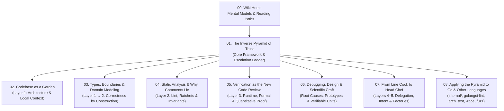

# Agent-Era Software Engineering Wiki

> **Distilled from Lauren Tan (`@poteto`) — SpaceXSI / Grok Bot, React Core Team (React Compiler), ex-Cursor, ex-Meta, ex-Netflix**
> Drawn from [*"All Code Is Slop (Except Mine)"*](https://www.youtube.com/watch?v=O_zcc6Xl12g) (AI Engineer CODE 2026), her live deep-dive with Matt Pocock, and the 24 software engineering principles encoded in [`pstack/`](../../pstack).

---

## What This Wiki Is About

This is **not** a plugin manual or slash-command reference. It is a **Software Engineering Wiki** exploring a single, urgent question:

> **When AI agents make writing code nearly free, what separates a codebase that compounds in quality from one that drowns in slop?**

Lauren Tan's answer is counterintuitive: **it is almost never about prompting tricks.** Shipping ~3,000 pull requests a month individually (and ~11,000/month across her team with a ~0.5% revert rate) did not come from cleverer system prompts. It came from **six months of investing in the engineering environment around agents**—treating the codebase, type system, static analyzer, verification harness, and feedback loops as a high-trust system where doing the right thing is the path of least resistance.

Her motto sums it up: **"If you want to go fast, go deep first."**

---

## Wiki Architecture

---

## Articles

| # | Article | Core Theme | Key Case Studies & Examples |
|---|---|---|---|
| **01** | [**The Inverse Pyramid of Trust**](./01-inverse-pyramid-of-trust.md) | Why deterministic constraints beat `AGENTS.md` prose; the cost gradient from architecture down to human review. | Low-Trust vs. High-Trust loop; the "Meat Proxy" Chrome DevTools story; solving the same bug at all 5 pyramid levels; Verifiability × Reversibility matrix. |
| **02** | [**Codebase as a Garden & Local-Context Architecture**](./02-codebase-as-a-garden.md) | Why your repository is the agent's largest prompt, and how directory structure and ruthless deletion steer output. | Grok Bot's eight 10k-line god files → Dune; the `setTimeout` weed (1 → 183 timers); banning `useEffect` in product code; Reader Load's 30-second test. |
| **03** | [**Types, Boundaries & Domain Modeling**](./03-types-boundaries-and-domain-modeling.md) | Making illegal states unconstructable, trusting internal types, and eliminating shared mutable state. | Discriminated unions vs. boolean bags; constructive modeling (`NonEmpty<T>`, `{ start, durationMs }`); Simplest Total Type; schema-derived types; idempotency & worktree separation. |
| **04** | [**Static Analysis, Agent-Directed Lint & Why Comments Lie**](./04-static-analysis-and-anti-comment-hygiene.md) | Turning repeated human review comments into mechanical walls that tell agents the exact fix. | Cutting 65,824 → 1,227 comments; writing agent-directed lint errors; the Ratchet Pattern (runnable example); time-boxed exceptions; observe-only background sweepers. |
| **05** | [**Verification as the New Code Review**](./05-verification-as-code-review.md) | Spending ~70% of tokens proving real behavior and shifting human review from diffs to evidence artifacts. | Defeating tautological tests (2-edit litmus test); Feature Maps & ARIA-driven control CLIs; 7-question benchmark vetting; TLA+, Lean, Bombadil & visual statecharts. |
| **06** | [**Debugging, Design & Scientific Engineering**](./06-debugging-design-and-scientific-thinking.md) | How top engineers diagnose failures, escape retry loops, and settle design decisions empirically. | Root cause vs. symptom guard; *Attack the Premise*; throwaway prototypes vs. abstract plans; *Sequence into Verifiable Units*; scientific hillclimbing. |
| **07** | [**From Line Cook to Head Chef: Delegation & Factories**](./07-human-in-the-loop-delegation-and-factories.md) | Scaling from one agent to parallel/overnight loops without multiplying unchecked slop. | Michelin-starred kitchen metaphor; transmission of intent; author ≠ verifier; 4 readiness gates before automation; solo multi-harness playbook. |
| **08** | [**Applying the Pyramid to Go (& Other Languages)**](./08-golang-and-cross-language-guide.md) | Translating Electron/TS ideas to Go (`internal/`, `golangci-lint`, `arch_test.go`, `-race`, fuzzing, `benchstat`) + Python/Rust Rosetta Stone. | Clearing up the "no lint in Go" myth; complete `.golangci.yml` with `depguard`/`forbidigo`/`nolintlint`; zero-dependency Go boundary test. |

---

## Suggested Reading Paths

- **Start here (The Big Picture):** Read [**01. The Inverse Pyramid of Trust**](./01-inverse-pyramid-of-trust.md) → [**02. Codebase as a Garden**](./02-codebase-as-a-garden.md).
- **Go developer fast track:** Read [**01. Inverse Pyramid**](./01-inverse-pyramid-of-trust.md) → [**08. Applying the Pyramid to Go**](./08-golang-and-cross-language-guide.md) → [**05. Verification**](./05-verification-as-code-review.md).
- **"My agents keep making the same mistakes over and over":** Read [**02. Codebase as a Garden**](./02-codebase-as-a-garden.md) → [**03. Types & Boundaries**](./03-types-boundaries-and-domain-modeling.md) → [**04. Static Analysis & Comments**](./04-static-analysis-and-anti-comment-hygiene.md).
- **"Tests pass, builds are green, yet broken code still ships":** Read [**05. Verification as Code Review**](./05-verification-as-code-review.md) → [**06. Debugging & Scientific Craft**](./06-debugging-design-and-scientific-thinking.md).
- **"I want to run parallel or overnight agents safely as a solo dev":** Read [**01. Inverse Pyramid**](./01-inverse-pyramid-of-trust.md) → [**05. Verification**](./05-verification-as-code-review.md) → [**07. Line Cook to Head Chef**](./07-human-in-the-loop-delegation-and-factories.md).

---

*Tip: Open [`index.html`](./index.html) directly in any browser for a small, offline static wiki reader. For the `pstack` plugin catalog appendix, see [`docs/pstack/`](../pstack/README.md).*
